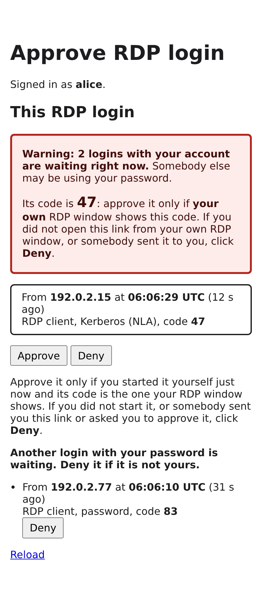
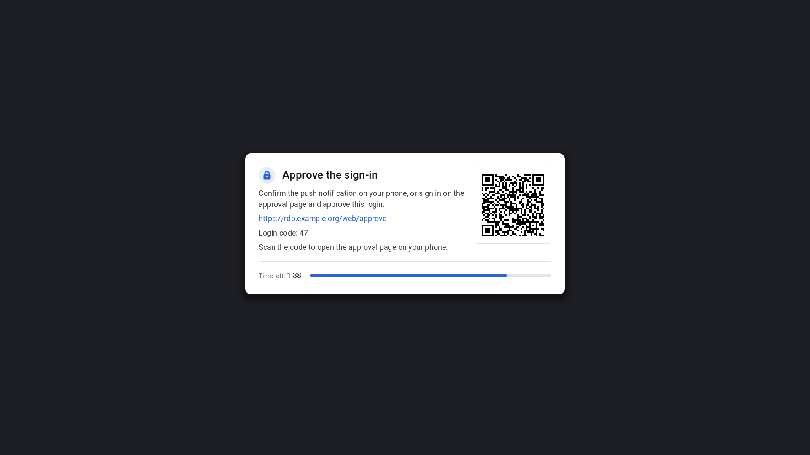

# Authentication and MFA

## What each login path gives you

| Client / method | First factor | Second factor (privacyIDEA) | Session gets a Kerberos TGT | Notes |
|---|---|---|---|---|
| NLA, user types a password (mstsc, xfreerdp3 `/u /p`, Remmina) | Kerberos (client gets a ticket with the password) | `push` (`otp_or_push`/`push`) | **yes, every RDP back-end.** xrdp (incl. wlroots): the delegated password reaches `pam_sss` through the xrdp PAM stack. GNOME, Plasma: the broker gets the TGT through PAM `fastrdp-tgt` before the session starts (`fastrdp_session_tgt: auto`); the back-ends themselves see only a per-session random secret | **Recommended.** The client must reach a KDC: VPN, or the KDC proxy on the web gateway (`fastrdp_web_kdcproxy`, [web-access.md](web-access.md#kdc-proxy); Windows by GPO, FreeRDP/MIT in `krb5.conf`). |
| NLA, single sign-on from a domain-joined Windows client | Kerberos ticket of the logged-on user | `push` (needs `fastrdp_privacyidea_service_user`: no password reaches the server) | only if Windows delegates the password: GPO "Allow delegating default credentials" **and no Credential Guard** (on by default on Windows 11 22H2+ Enterprise/Education; it blocks delegating SSO and saved credentials, mstsc then prompts and delegates the typed password); then as the row above, for every back-end. `mstsc /restrictedAdmin` logs in without a prompt but never delegates a password | Without the GPO mstsc prompts instead of SSO. Remote Credential Guard (`/remoteGuard`): see its own row. Without a password no session has a TGT (`kinit` inside the session); `fastrdp_session_tgt: required` refuses such logins. See [windows-clients.md](windows-clients.md) §3.5, and §3.12 for how a Windows RDP host gets its Kerberos credentials in each mode |
| NLA, single sign-on from a Linux ticket (`xfreerdp3 … /p` with an empty value, after `kinit` or a desktop login with a TGT) | Kerberos ticket from the client's cache | `push` (needs `fastrdp_privacyidea_service_user`: no password reaches the server) | **no** (no password is delegated; `kinit` inside the session). Without `/p`, xfreerdp3 prompts and the typed password gives the session a TGT, as in the first row | Refused with `fastrdp_session_tgt: required`. Details: [freerdp-client.md](freerdp-client.md) §2 |
| TLS, password+OTP in one field | PAM `fastrdp` (SSSD) | OTP appended to the password (`otp`, `otp_or_push`) | yes, every RDP back-end (as above) | For clients without Kerberos. Needs `fastrdp_allow_tls_logins: true`; `fastrdp_tls_login_sources` (proxy `AllowTlsFrom`) can limit it to client networks. Without it, TLS is offered only for the web path and accepted from loopback only. |
| Web: Guacamole + Keycloak | Keycloak (OIDC) | at Keycloak (OTP, WebAuthn/FIDO2, privacyIDEA), proven by `acr`/`amr` | no (refused with `fastrdp_session_tgt: required`) | `fastrdp_web_enabled`; see [web-access.md](web-access.md) |
| NLA with a passkey-derived TGT (FreeIPA, Linux client) | Kerberos: passkey pre-authentication at the KDC (`kinit -T` / sssd), TGT carries indicator `passkey` | `push`; **skipped** with `fastrdp_mfa_nla_kdc_enforced: true` when the KDC requires `passkey`/`pkinit` for `TERMSRV` (FreeIPA auth indicators; checked by preflight and the identity role) | no (no password) | Lab stage: [passkeys.md](passkeys.md) stage 2, `tests/lab/freeipa-passkey-nla.sh`. Not for AD (no auth indicators) |
| NLA, Remote Credential Guard (`mstsc /remoteGuard`, GPO "Require Remote Credential Guard"; FreeRDP `/remoteGuard`) | Kerberos ticket of the logged-on user; then TSRemoteGuardCreds (service ticket + TGT) instead of a password | as SSO: `push` with `fastrdp_privacyidea_service_user`, skipped with `fastrdp_mfa_nla_kdc_enforced` | **no.** The proxy module discards the forwarded tickets (identity only); refused with `fastrdp_session_tgt: required`. gssproxy S4U for NFS works as for SSO | **Refused by default**: the proxy answers the negotiation with "not supported" and mstsc shows its own error. `fastrdp_accept_remote_guard: true` accepts it identity only; the broker logs `remote credential guard: identity only, credentials discarded` (request field `remote_guard`). Using the credentials (MS-RDPEAR) is not implemented. [windows-clients.md](windows-clients.md) §3.12 |
| Smartcard / PIV / YubiKey PIV (NLA) | Kerberos via **PKINIT** (certificate + PIN) | `push`, or exempt group for "smart card required" accounts; **skipped per login** when the ticket carries an item of `fastrdp_mfa_kdc_evidence_as_mfa` (FreeIPA `ind:pkinit`; AD an AMA group or `sid:S-1-18-3`) | no (PIN is never forwarded; refused with `fastrdp_session_tgt: required`) | Tested with a software token; real cards/AD/mstsc to validate. See [smartcard-nla.md](smartcard-nla.md) |

### Kerberos TGT per back-end

| Back-end | Who gets the TGT | Logins that give one | Renewal |
|---|---|---|---|
| xrdp (X11, wlroots) | xrdp-sesman's PAM stack (`pam_fastrdp_token` hands the password to `pam_sss`) | NLA with delegated password, TLS | sssd (domain), sssd-kcm; each reconnect with a password gets a new TGT |
| GNOME, Plasma | the broker, before the session starts: PAM service `fastrdp-tgt` (`pam_sss` only), checked with `klist -s` as the user | NLA with delegated password, TLS (`[broker] session_tgt = auto` or `required`) | as xrdp; each login with a password, including a reconnect to the running session, gets a new TGT |
| Web | nobody | – | – |

`fastrdp_session_tgt` (`[broker] session_tgt`): `auto` (default) logs a failed TGT
request and continues; `required` refuses failed requests and refuses logins without
a password (SSO without delegation, Remote Credential Guard, smartcard, web) before MFA;
`off` never asks. `fastrdp_session_tgt_groups` (`[broker.session_tgt_groups]`,
group = mode) sets the mode per group: members of listed groups get the strictest mode
of their groups (`required` > `auto` > `off`), everybody else `fastrdp_session_tgt`;
e.g. `required` only for users with Kerberized homes
([nfs-kerberos-homes.md](nfs-kerberos-homes.md#c-require-a-typed-password-for-users-with-kerberized-homes)).
Details: [backends/gnome.md](backends/gnome.md#kerberos-ticket-tgt),
[nfs-kerberos-homes.md](nfs-kerberos-homes.md).

**Who is about to lose Kerberos access:** `sudo fastrdpctl status` lists, for each
account with a session, the TGT in the user's default credential cache (the cache the
session's processes use): principal, expiry and renewal limit (UTC, with the time left)
and a state: `ok`, `expiring` (less than 1 h left), `not_renewable_soon` (not
renewable, or renewal ends within 24 h: the next login with a password gets a new one),
`expired`, `none` (no TGT, e.g. SSO or smartcard login) or `unknown` (klist failed).
`fastrdpctl tickets [USER]` shows only that table, also for an account without a
session; `--json` for scripts. Only metadata: no ticket or key data
([nfs-kerberos-homes.md](nfs-kerberos-homes.md#q4-ticket-lifetime-and-renewal)).

**Sessions longer than the renewable lifetime** (`fastrdp_krb5_renewable_lifetime`,
default 7 days after the last login with a password): sssd cannot renew the TGT any
further, and the session loses Kerberized NFS/SMB homes and shares. Users see a desktop
notification 24 h and 2 h before that and once when the TGT has expired
(`fastrdp_tgt_notify*`, every desktop; nothing without a TGT). What renews: a reconnect
with a password (every back-end, also to the running session) or `kinit` in the
session; lock/unlock is no reliable way in fastrdp sessions. Without any of this:
gssproxy impersonation for the mounts
([nfs-kerberos-homes.md](nfs-kerberos-homes.md#long-running-sessions)).

YubiKeys work in three ways:
- **PIV smartcard** (NLA logon via PKINIT);
- **YubiKey OTP** (44 modhex characters appended to the password, detected
  automatically);
- TOTP/HOTP tokens enrolled in privacyIDEA.

FIDO2/WebAuthn is available on the web path (at Keycloak).
Passkeys (YubiKey FIDO2, KeePassXC, Bitwarden, Windows Hello, phones) per login path: [passkeys.md](passkeys.md).
FreeRDP and Remmina settings for each login path (exact switches, errors): [freerdp-client.md](freerdp-client.md).

## MFA modes (`fastrdp_mfa_mode`)

| Mode | NLA logins | TLS logins |
|---|---|---|
| `none` | – | – |
| `otp` | **refused** (no channel for an OTP) | OTP must be appended to the password |
| `push` | push challenge | push challenge |
| `otp_or_push` | push challenge | appended OTP if present, otherwise push |
| `web` | approval on the web gateway's `/web/approve` page | approval on `/web/approve` |
| `push_or_web` | push challenge **and** approval on `/web/approve`; the first answer wins | as NLA (an appended OTP is not split off) |
| `code_or_web` | authenticator code typed on the [waiting screen](#waiting-screen), checked by Keycloak, **or** approval on `/web/approve` (passkey); the first success wins | as NLA |

`web`, `push_or_web` and `code_or_web` need `fastrdp_web_enabled: true`; `web` and
`code_or_web` need no privacyIDEA ([Web approval](#web-approval),
[Code on the waiting screen](#code-on-the-waiting-screen)). Web logins (Guacamole) are unaffected by every mode:
their second factor is at Keycloak.

**`fastrdp_mfa_nla_kdc_enforced`** (broker `[mfa] nla_kdc_enforced`, default off):
Kerberos NLA logins whose principal is in `[auth] realms` skip the second factor,
logged as `second factor skipped: [mfa] nla_kdc_enforced`. TLS and web logins are
unchanged. Only safe when the KDC refuses `TERMSRV/<host>` tickets to password-only
TGTs: FreeIPA `ipa service-mod TERMSRV/<host> --auth-ind=passkey --auth-ind=pkinit`
(the identity role sets and verifies this; preflight reads it). Details, the AD case
and the security review: [passkeys.md](passkeys.md#kdc-enforced-strong-authentication-for-nla).

**`fastrdp_mfa_kdc_evidence_as_mfa`** (broker `[mfa] kdc_evidence_as_mfa`, default `[]`):
the same per login, from what the KDC wrote into the ticket. A Kerberos NLA login of a
principal in `[auth] realms` whose ticket carries one of the listed items skips the
second factor, logged as `second factor from KDC evidence <item>`: `ind:<indicator>`
(FreeIPA/MIT authentication indicators such as `ind:pkinit`, `ind:passkey`) or
`sid:<SID>` (AD PAC group SIDs such as `sid:S-1-18-4` for Windows Hello for Business key
trust, or an Authentication Mechanism Assurance group). Logins without a matching item
keep their second factor unchanged; the client sees no difference. The proxy's FreeRDP
checks the KDC's signature over the evidence (`patches/freerdp/0005`); the client's
`smartcard` flag never counts. Such a login earns reconnect grace like a push. Items,
refusals, caveats (freshness, shadow credentials):
[passkeys.md](passkeys.md#kdc-evidence-per-login).

### Reconnect grace

**`fastrdp_mfa_reconnect_grace`** (broker `[mfa] reconnect_grace`, seconds, default
`0` = off, at most 3600) and **`fastrdp_mfa_reconnect_grace_same_address`**
(`[mfa] reconnect_grace_same_address`, default `true`). `scripts/fastrdp-setup` does
not ask for them; add them to the generated `group_vars/all/main.yml` by hand.

Why: neither the proxy nor xrdp supports RDP auto-reconnect cookies
([rdp-spec-conformance.md](rdp-spec-conformance.md#6-redirection-load-balancing-reconnect)).
After every network drop (Wi-Fi roaming, VPN reconnect, laptop lid) mstsc reconnects
with a full login: NLA, silent with a Kerberos ticket, and then a new push. With a
grace period the broker skips the second factor for such a reconnect and logs

```
alice: nla login from 192.0.2.10; second factor skipped: reconnect grace (push passed 212s ago from 192.0.2.10)
```

How it works:

- **What earns grace:** only a login whose second factor privacyIDEA confirmed (OTP or
  push), Keycloak confirmed (a [code on the waiting screen](#code-on-the-waiting-screen),
  factor `keycloak_otp`), the user approved on the web approval page, or the KDC's evidence in the ticket
  (`kdc_evidence_as_mfa`, factor `kdc <item>`), *and* whose session then started (the
  broker handed the target to the proxy).
  Refusals, wrong or missing OTPs, push timeouts, privacyIDEA errors and back-end errors
  record nothing. Logins that never asked privacyIDEA record nothing either: exempt
  groups, `nla_kdc_enforced`, web logins (their MFA is at Keycloak), `mode = "none"`.
- **What must match** (all of it):
  - the local account;
  - the login method, i.e. the class of the first factor: `nla` (a Kerberos ticket for
    `TERMSRV`) or `tls` (password checked by PAM). A push approved for an NLA login never
    lets a TLS password login skip it, and the other way round: the two are stolen in
    different ways (a ticket cache or a delegated credential vs. a typed password), so
    holding one kind must not ride on MFA that was passed with the other. mstsc
    reconnects with the method it used before, so this costs nothing;
  - NLA: the Kerberos principal from the ticket (as the KDC canonicalised it). The
    `principal` field of a TLS login is client-supplied and ignored, and so is the
    `smartcard` flag (a PKINIT and a password-derived ticket for the same principal are
    the same class: the broker cannot tell them apart);
  - with `reconnect_grace_same_address = true`: the client address the proxy sees
    (the TCP peer, not the client-supplied ClientAddress). A login without a known
    address then never uses or earns grace.
- **Absolute, not sliding:** the period counts from the last *real* second factor, also
  when the session took a while to start. Logins that used grace do not extend it; the
  next real push or OTP starts a new period. A sliding window would let somebody who
  keeps reconnecting stay MFA-free forever.
- **Still checked on every login:** the first factor (Kerberos NLA, or the PAM password
  check for TLS), `[auth] allow_groups`, the PAM account phase (expired, locked,
  `pam_access`, AD GPO logon right), `session_tgt = "required"`, realms. Grace replaces
  the privacyIDEA call and nothing else.
- **TLS with OTPs:** mstsc reconnects with the stored `password+OTP`. Within the grace
  period the appended (now used) OTP is split off and not sent to privacyIDEA, so the
  reconnect is not refused as an OTP replay. In `otp` mode a TLS reconnect without an
  appended OTP is accepted too while grace applies; without grace it is refused before
  the password check, as before.
- **Memory only:** entries live in the broker process (pruned when they expire).
  `systemctl restart fastrdp-brokerd` (and every upgrade) forgets all of them; the next
  login of each user asks for the second factor again.
- **Revoking:** `fastrdpctl clear-grace alice` forgets alice's entries (local account
  name as in the broker log), `fastrdpctl clear-grace` everybody's. A login whose second
  factor was passed before the clear and whose session is still starting records
  nothing. `fastrdpctl status` shows `mfa_grace_entries`. `fastrdpctl logout` does not
  clear grace; on a suspected compromise run both, and lock the account or revoke the
  token.

Security review:

- **What it weakens:** within the period, a second login from the same address needs
  only the first factor. An attacker who has the user's Kerberos ticket (or can obtain
  one: the password) **and** connects from the same address (shared NAT, VPN
  concentrator, the user's own compromised machine) right after the user passed MFA
  gets in without a push. With `reconnect_grace_same_address = false` any address will
  do, i.e. MFA is effectively "once per N seconds per user and method": use that only
  where clients' addresses change on every reconnect (mobile networks) and the period
  is short.
- **What it does not weaken:** the first factor, account and group checks, the realm
  check, and the binding to the principal. Grace never starts from a login that did
  not pass privacyIDEA (or present matching KDC evidence), so it cannot extend
  `nla_kdc_enforced`, exempt groups or the web path, and a refused login (R1 reasons `denied`, `not_allowed`, `mfa_failed`,
  `mfa_timeout`, `backend`) never creates an entry. The reply to a refused login is the
  same with or without grace.
- **A compromised client machine** already controls the running session, so grace
  adds little there. A malicious push approved by mistake (push fatigue) is
  extended by the period: `fastrdpctl clear-grace` limits that once noticed.
- **`session_tgt`:** grace does not touch it. A grace login with a password (TLS, NLA
  with delegation) still gets a fresh TGT for GNOME/Plasma; with
  `session_tgt = "required"` (globally or for one of the user's
  `session_tgt_groups`) a passwordless login is still refused.
- **Recommended values:** `300`–`900` seconds with the address binding on. That covers
  a network drop, a VPN reconnect or moving between meeting rooms, but not the next
  morning. Keep it `0` where every login must show a fresh second factor (e.g. admin
  hosts). The 3600 s limit keeps this a reconnect aid, not a replacement for MFA.
- **Not covered:** a broker restart forgets grace (safe direction); several proxy hosts
  each have their own broker and grace; the web path is unchanged.

During a push the client waits: the [waiting screen](#waiting-screen) (on by default)
shows a panel that says what to do; without it the client shows only its own
"connecting…" state or a black window. `fastrdp_proxy_broker_timeout`
(default 180 s, proxy.ini `[FastRDP] Timeout`, at most 600) is one wait for the whole
broker call: the push (privacyIDEA `push_timeout`, default 60 s) or web approval
(`fastrdp_mfa_web_approval_timeout`, default 90 s) **plus** the session start that
follows it (broker `session_start_timeout`, 90 s; first GNOME/Plasma starts can take
most of it). With web approval the common checks require
`fastrdp_proxy_broker_timeout` ≥ `fastrdp_mfa_web_approval_timeout` + 90; for push,
keep it at least `push_timeout` + 90 (privacyIDEA's setting is not checked).

### Web approval

**`fastrdp_mfa_mode: web`** (broker `[mfa] mode = "web"`): an RDP login that owes its
second factor waits in the broker, as during a push, until the user approves it in a
browser. **`push_or_web`** sends a privacyIDEA push at the same time; whichever answers
first wins and the other is cancelled. Both need the web gateway
(`fastrdp_web_enabled: true`, [web-access.md](web-access.md#approving-rdp-logins)).

1. The user starts the login in mstsc/xfreerdp3 (NLA or TLS). The first factor, groups
   and account are checked as always; the client shows the [waiting screen](#waiting-screen)
   with the approval URL, the login's code and a QR code ("connecting…" without it).
2. The broker logs `web approval pending for alice from 192.0.2.10` and keeps the login
   pending (memory only).
3. The user opens `https://<host>/web/approve`, or scans the QR code, which opens
   `https://<host>/web/approve?login=<id>` for this very login (the
   [login-bound link](#login-bound-link-qr-code)). The webgate sends them to Keycloak for a
   **fresh** sign-in (`prompt=login`, `max_age=0`) with the usual MFA proof
   (`acr`/`amr`: passkey, TOTP, WebAuthn, privacyIDEA), and checks the ID token's
   `auth_time`, so an existing Keycloak session does not count. A sign-in without that
   proof gets the page *Second factor required*
   ([web-access.md](web-access.md#symptom-acr-1-does-not-prove-mfa)). This is the
   desktop client's flow: a passkey, or password **again** plus OTP or security key.
   The Keycloak username (the `username_claim` after
   `strip_domains`) must equal the RDP login's local account: the broker shows and decides
   only that account's pending logins.
4. The page lists the user's pending logins with client address, start time, login
   method and a two-digit **code**, the same one the [waiting screen](#waiting-screen) and
   the notification show, so the user can tell which login is theirs; opened from the
   QR code, that login first. **Approve** lets the broker continue (session start or reuse, as after a
   push); **Deny** fails the login with `mfa_failed` (Set Error Info 0x7). Without a
   decision within `fastrdp_mfa_web_approval_timeout` the login fails with
   `mfa_timeout` (0x409). Closing the RDP client removes the pending login.

**Notifications (opt-in):** users who turned them on at `https://<host>/web/notify` get
a phone or browser notification at step 2, "approve your RDP login from 192.0.2.10
(code 42)", linking to the fixed `https://<host>/web/approve` (never to a login-bound
link: whichever login waits triggers the notification, possibly an attacker's); steps 3
and 4 stay the same, the notification approves nothing. ntfy and Web Push, rate limit, privacy:
[notifications.md](notifications.md) (`fastrdp_web_notify_backends`, default off).

| Variable (broker key) | Default | Meaning |
|---|---|---|
| `fastrdp_mfa_web_approval_timeout` (`web_approval_timeout`) | `90` | seconds a login waits for the decision, 10..510. In `push_or_web` it bounds the whole wait (keep `push_timeout` below it). `fastrdp_proxy_broker_timeout` (default 180) must be at least this plus 90 s for the session start after the approval (`session_start_timeout`; checked): raise the proxy's timeout along with this one. 510 = the module's 600 s limit minus the session start |
| `fastrdp_mfa_web_approval_max_auth_age` (`web_approval_max_auth_age`) | `30` | the approving sign-in may be at most this many seconds older than the pending login (0..300). Signing in first and starting the login afterwards works only within this window; otherwise the page asks to sign in again |
| `fastrdp_mfa_web_approval_single_pending` (`web_approval_single_pending`) | `true` | with two or more pending logins of one user, none can be approved (each can still be denied); the user denies them and starts one new login. Not for the login named by the [login-bound link](#login-bound-link-qr-code) |

**Why `single_pending`:** whoever has the user's password (or Kerberos ticket) can start
an RDP login of their own at the moment the user starts theirs. The page shows both,
and the user cannot reliably tell which one is theirs (a shared NAT address looks the
same). Refusing approval while more than one is pending turns that race into a visible
warning instead of a coin toss.

**What the broker checks** for each decision (ops `mfa_pending`/`mfa_decide`, accepted
only from the webgate's uid, `[web] gateway_user`): the request belongs to the account
the webgate signed in (another user's request looks unknown); it is still pending
(already approved, denied, timed out or abandoned requests get a clear refusal);
`auth_time` and `single_pending` as above, for Approve. `single_pending` is skipped only
for a decision the webgate marks `bound` (the user came with that login's id); nothing
else is relaxed. Deny is always accepted.

**Reconnect grace:** a login passed by web approval records the factor `web`; reconnects
within `fastrdp_mfa_reconnect_grace` skip the approval like they skip a push.
Exempt groups and `fastrdp_mfa_nla_kdc_enforced` skip it before it starts, as for push.

Security notes:
- **Social engineering:** an attacker who has the password may call the user and ask
  them to "approve the login on the web page". The page says to approve only a login
  the user started themselves just now, from the address shown, and to deny everything
  else. A denied login is logged (`web approval for alice from … DENIED`); treat
  unexpected denials as a stolen password.
- The approval sign-in needs the same MFA proof as the browser path (passkey, TOTP,
  WebAuthn at Keycloak), so web approval is as strong as that, and lets users with
  only a passkey reach RDP logins ([passkeys.md](passkeys.md)).
- The approval cookie (`fastrdp_web_approve`, 5 minutes) only allows decisions, no
  desktop access, and is separate from the desktop chooser's sign-in.
- `fastrdpctl status` shows the number of pending approvals
  (`mfa_pending_approvals`) and, with notifications, the events sent and dropped.
  Pending logins are memory only: a broker restart fails them.
- The code is a convenience for telling logins apart, not a secret (two digits); the
  safeguards are the fresh sign-in, `single_pending` or the
  [login-bound link](#login-bound-link-qr-code), and the user's judgement.

#### Login-bound link (QR code)

The QR code on the [waiting screen](#waiting-screen) opens
`<fastrdp_ui_approve_url>?login=<id>`, where `<id>` is the broker's id of exactly that
pending login (128 random bits). The waiting screen's text keeps the short URL and the
code for typing on another device; that way gets the plain page as before.

- The `login` parameter survives the Keycloak round trip (kept in the signed pending
  sign-in cookie, like the return target; strictly checked, at most 64 characters). The
  page still wants the **fresh MFA sign-in**: the id is no credential and approves
  nothing on its own.
- Opened with an id of one of the signed-in user's pending logins, the page shows that
  login prominently (address, start time, login method, code) with **Approve** and
  **Deny**. Approving it is allowed even while other logins of the user wait
  (`single_pending` does not apply to it; the broker logs `approved via the login-bound
  link`); the others are listed below with "Another login with your password is waiting.
  Deny it if it is not yours." and only **Deny**. While others wait, a red warning box
  above the buttons says how many logins with the account are waiting, shows this
  login's code in large type ("approve it only if **your own** RDP window shows this
  code") and says to deny a link somebody sent. Approving stays possible (the user's
  choice); the broker and the webgate then log a warning (`... via the login-bound link
  while N other login(s) of the account waited`). `mfa_decide` answers with
  `others_pending`, the number of the user's own other waiting logins (no ids, nothing of
  other users).
- An id that is unknown, finished or another user's reads the same after the sign-in:
  "This login is no longer waiting for approval.", followed by the user's own pending
  logins under the usual rules; a malformed one gets that message at once. The page
  tells nobody whether an id exists.
- **Why this is safe with a parallel login:** an attacker who has the password can start
  a login of their own at the same moment, but it gets a different id, which only the
  attacker's screen shows. The QR code on the user's own screen can only name the user's
  own login, so the race that `single_pending` guards against cannot make the user approve
  the wrong one; the attacker's login stays pending and can be denied.
- **Phishing:** someone with the password could send the user *their* login-bound link
  ("please approve quickly"), timed so that the user's own login waits too. The page
  then shows the attacker's login: an address and start time the user does not
  recognise and a code that is not the one in the user's RDP window, with the warning
  box above (two logins waiting, compare the code) when the user's own login waits as
  well. Never approve a login
  you did not start, and scan only the QR code in your own RDP window.
- Notifications never carry the id; typed URLs and bookmarks have none (plain page).



*The login-bound page while a second login of the account waits (example data).*

### Code on the waiting screen

**`fastrdp_mfa_mode: code_or_web`** (broker `[mfa] mode = "code_or_web"`): Keycloak is the
only MFA service, and both kinds of second factor work for every RDP client, NLA with a
Kerberos ticket included:

- **TOTP:** the user types the code from the authenticator app into the RDP window. The
  [waiting screen](#waiting-screen) shows a field below its text; the proxy module reads
  the digits and sends them to the broker, which has Keycloak check them.
- **Passkey:** the user approves the login on `/web/approve` as with
  [web approval](#web-approval): the QR code and the URL are on the same panel.

The first success wins; the other way is cancelled. Nothing is appended to the password,
so Kerberos NLA logins work as they are.

**How Keycloak checks the code.** Keycloak has no API that only verifies a code. The
broker signs the user in through a **direct grant** of its own confidential client
(`fastrdp-otp-check`, sample `docs/examples/keycloak-fastrdp-otp-check-client.json`):
username and code, **no password**. That client's direct grant flow:

```
fastrdp-otp-check (direct grant flow of the client fastrdp-otp-check only)
├─ Username Validation                       REQUIRED
├─ fastrdp-otp-check - otp                   CONDITIONAL (sub-flow)
│  ├─ Condition - user configured            REQUIRED
│  └─ OTP                                    REQUIRED  reference value "otp" (goes into amr), max age 60 s
└─ fastrdp-otp-check - no otp                CONDITIONAL (sub-flow)
   ├─ Condition - sub-flow executed          REQUIRED  "fastrdp-otp-check - otp", not executed
   └─ Deny access                            REQUIRED  error message "fastrdp_no_otp"
```

A user with an OTP credential must pass the OTP step; a user without one is denied with
`fastrdp_no_otp`, which the broker tells apart from a wrong code. A token counts only if
its `amr` claim contains `otp` (the client's mapper *fastrdp amr* puts the OTP step's
reference value there). The broker ends that Keycloak session at once (logout with the
refresh token) and throws the tokens away (`broker/brokerd/fastrdp_broker/keycloak_otp.py`).
[tested: Keycloak 26.8.1, `make test-keycloak`]

**Two safeguards against a flow changed by hand.** A conditional flow is one wrong
setting away from letting a username alone through: with the *no otp* sub-flow disabled,
Keycloak issued a token to a user without OTP for the name alone [tested].
1. The role (`fastrdp_keycloak_passkeys.py`) compares the flow exactly on every run, in
   check mode too: steps, order, requirements and configs. Any difference is a warning
   naming the step ("differs from the wanted structure … rebuilt"), and the flow is
   rebuilt (check mode: reported only). The same for the amr mapper.
2. The broker accepts a token only with `otp` in `amr` (and this issuer, this client as
   audience and `azp`, not expired). A flow that skips the OTP step gives `amr: []`
   [tested]. Such a token, and every other unexpected answer, closes the code field for
   this login with "Codes cannot be checked at the moment", costs no attempt and is
   logged as an error (`Keycloak flow issued a token without 'otp' in amr …`). The
   signature is not checked: the token comes straight from the token endpoint over TLS
   in answer to the client's authenticated request (OpenID Connect Core 3.1.3.7).

Safeguard 2 protects against a broken flow, not against a Keycloak administrator who
sets the reference value on another step; safeguard 1 reports that at the next run.

| Check (Keycloak 26.8.1) | Result |
|---|---|
| right code, through `fastrdp-otp-check` | accepted; no Keycloak session left after the logout [tested] |
| wrong code | refused (HTTP 400 `invalid_grant`), counted [tested] |
| unknown user | refused (HTTP 400) [tested in a research run, not in `make test-keycloak`] |
| user without an OTP credential (password-only or passkey-only users) | denied (HTTP 401 `{"error": "fastrdp_no_otp"}`, as JSON because the broker sends `Accept: application/json`); **not counted**: the field closes with "No authenticator app is set up for your account. Approve with your passkey: scan the QR code." [tested] |
| wrong client secret or client id | HTTP 401 `unauthorized_client`: not counted, the field closes ("Codes cannot be checked at the moment"), error in the journal [tested] |
| flow changed by hand (*no otp* sub-flow disabled; *Deny access* disabled) | a token without `otp` in `amr` (HTTP 200), or HTTP 500: the broker refuses both, not counted, the field closes; the role's check mode reports the flow, a run rebuilds it [tested] |
| user with a pending required action | refused (HTTP 400 "Account is not fully set up", counted like a wrong code): nothing can be enrolled this way [tested] |
| username + code through any other client (the webgate's, `admin-cli`) | refused: the shortened flow exists only behind this client's secret [tested] |
| the same code twice | refused, **if** the realm keeps OTP codes single-use (`otpPolicyCodeReusable` off, Keycloak's default); the role warns otherwise [tested] |
| token exchange with the check's token | refused (standard token exchange off, full scope off, no audience mapper; the role refuses a client with any of them) [tested in a research run, not in `make test-keycloak`] |
| several OTP devices of a user | only the user's **default** OTP credential counts [verified: source, `ValidateOTP`] |

**Why only the broker can use it:** the client is confidential and its secret is on the
RDP host only (`/etc/fastrdp/keycloak-otp.secret`, root). The flow without a password is
bound to that client alone (`authenticationFlowBindingOverrides.direct_grant`); the realm's
own flows and every other client stay as they are. A direct grant sets no browser cookie,
so no other application can be signed in through such a check. The broker asks for the
code only after the first factor passed (Kerberos ticket or PAM password), so nobody can
guess codes with a username alone.

**Limits per login and per user:**

| Variable (broker key) | Default | Meaning |
|---|---|---|
| `fastrdp_mfa_code_attempts` (`code_attempts`) | `3` | wrong codes per login; then the login fails (`mfa_failed`) |
| `fastrdp_mfa_code_user_failures` (`code_user_failures`) | `10` | wrong codes of one user within the window: the code field stays closed for that user ("Too many wrong codes"), the approval page still works |
| `fastrdp_mfa_code_failure_window` (`code_failure_window`) | `900` | seconds that window covers |
| `fastrdp_mfa_keycloak_issuer` (`[mfa.keycloak] issuer`) | the webgate's `fastrdp_web_oidc_issuer` | the realm |
| `fastrdp_mfa_keycloak_client_id` (`client_id`) | `fastrdp-otp-check` | the confidential client |
| `vault_fastrdp_mfa_keycloak_client_secret` | – | its secret (`client_secret_file`, read at every check) |
| `fastrdp_mfa_keycloak_ca_src` (`ca_file`) | the webgate's CA | Keycloak's CA, "" = system trust store |
| `fastrdp_mfa_keycloak_timeout` (`timeout`) | `10` | seconds per check |
| `fastrdp_mfa_keycloak_required_amr` (`required_amr`) | `otp` | a token counts only with this value in `amr`; the role sets it as the OTP step's reference value |

A Keycloak that cannot be reached costs no attempt ("The code could not be checked"; the
field stays). Answers that are neither a token with `otp` in `amr`, a wrong code
(`invalid_grant`) nor the *Deny access* of a user without OTP close the field for this
login without an attempt: they point to a setup error, and leaving the field open would
let a Keycloak that answers oddly to wrong codes be used for unlimited guesses.
`fastrdp_mfa_web_approval_timeout` bounds the whole wait, a check under way included.
Keycloak's own brute-force detection counts the wrong codes on top; turn it on in the
realm (the role warns when it is off).

**Set up:**
1. Import `docs/examples/keycloak-fastrdp-otp-check-client.json` into the realm
   (*Clients → Import client*) and copy its secret (*Credentials*) into the vault as
   `vault_fastrdp_mfa_keycloak_client_secret`.
2. `fastrdp_mfa_mode: code_or_web`, `fastrdp_web_enabled: true` (the approval page),
   `fastrdp_proxy_waiting_screen: true` (default). With `fastrdp_web_passkeys: true` the
   web_gateway role also creates the direct grant flow `fastrdp-otp-check` (above) and
   the client's amr mapper, binds the flow to the client, compares both on every run and
   refuses an unsafe client (public, browser flow, implicit flow, service
   account, device or CIBA grant, standard token exchange, full scope, an audience
   mapper); it warns about reusable OTP codes and missing brute-force detection. Without
   Ansible: [keycloak-mfa/README.md](examples/keycloak-mfa/README.md#scenario-2-approving-rdp-logins).
3. Users need TOTP in Keycloak, or a passkey for the approval page. Users without TOTP
   see the hint to the passkey after their first code.

**What users see:** the panel says "Type the code from your authenticator app below, or
sign in on the approval page (passkey) and approve this login", the URL, the login code,
the QR code and the field *Authenticator code: ••••__*. Digits count by key position, so
the top row works on every layout (also AZERTY without Shift), the keypad with NumLock;
Backspace deletes, Esc clears, the sixth digit (or Enter, with several configured
`fastrdp_otp_lengths`) sends the code. The field then shows "Checking the code…"; a wrong
code brings the field back with "Wrong code. Attempts left: 2".

**Security notes:**
- A code typed in the user's own RDP window can only pass that login; somebody with the
  password and a parallel login gets nothing from it (unlike push and the plain approval
  page, which need `single_pending` or the [login-bound link](#login-bound-link-qr-code)).
- A fake RDP server that relays everything live (password, then the code) defeats TOTP as
  it defeats push and web approval. Only RDP-level server authentication helps: Kerberos
  NLA (mutual authentication), or a server certificate the client checks.
- Whoever holds the client secret can check codes for any user and, by guessing, lock
  accounts out through Keycloak's brute-force detection. Keep it on the RDP host only.
- The code is never logged (broker, module), and the module wipes it once sent.
- Clients without the field (no waiting screen, a module without `patches/freerdp/0007`)
  get the approval page only.

**Not tested yet:** typing the code in real clients (mstsc, Windows App on macOS/iOS,
Remmina): which keyboard events they send to the panel. The proxy module's part is built
and syntax-checked against FreeRDP 3.32.2 with fastrdp's patches, and its key handling
has unit tests (`tests/proxy-module/test_code.c`); see [backlog.md](backlog.md) W5 and
the lab plan [lab-waiting-screen-input.md](lab-waiting-screen-input.md).

**Input trace for the client lab** (`fastrdp_proxy_input_trace`, proxy.ini
`[FastRDP] InputTrace`, default `false`, **lab only**): the proxy logs one line per input
event the waiting screen reads (code field and desktop picker), with the event's
**class** only, e.g.

```
[…] input trace: scancode top-row digit up (code field), code field 3 of 6 digits
[…] input trace: unicode other down (code field), before the prompt
[…] input trace: sync NumLock off CapsLock off (code field), code field 0 of 6 digits
```

Classes: scancode `top-row digit`, `keypad digit`, `keypad digit key (NumLock off)`,
`backspace`, `esc`, `enter`, `keypad enter`, `modifier`, `caps lock`, `num lock`,
`other`, `other (extended)`; Unicode `digit`, `full-width digit`, `backspace`, `enter`,
`esc`, `other`; `sync` with the NumLock and CapsLock state; `mouse` button 1–3 down/up
(no position, no moves). It never logs a digit's value, a key code or a character: all
digit keys of one source share one class, and non-digit characters are one class
because AZERTY's unshifted digit row (`&é"'(-è_çà`) is made of them
(`broker/proxy-module/fastrdp_inputtrace.h`, `tests/proxy-module/test_inputtrace.c`).
The field's length is logged, which the masked field shows on the screen anyway. Still,
the trace tells *that* and *when* digits were typed: the proxy warns on every
connection while it is on; switch it off after the lab.

### Waiting screen

**`fastrdp_proxy_waiting_screen`** (proxy.ini `[FastRDP] WaitingScreen`, default
`true`, also the module's default when proxy.ini lacks the key): while the broker works
on a login, the RDP client shows a panel instead of a black or "connecting…" window.
The RDP connection is already active at that point (the proxy asks the broker from its
PostConnect callback), so the module can draw with Bitmap Updates, which every client
must accept ([rdp-spec-conformance.md](rdp-spec-conformance.md#waiting-screen-bitmap-updates)).

| Login state | What the user sees |
|---|---|
| broker called | "Signing you in…" (the module's own text; also all an older broker ever gives) |
| push (`push`, `otp_or_push` without OTP) | "Approve the sign-in / Confirm the push notification for alice on your phone." and a countdown of privacyIDEA's `push_timeout` |
| web approval (`web`) | "Sign in on the approval page and approve this login:", the approval URL, "Login code: 42" (the code the approval page and the [notification](notifications.md) show), a **QR code** of the [login-bound link](#login-bound-link-qr-code) `<URL>?login=<id>` ("Scan the code to open the approval page.") and a countdown of `fastrdp_mfa_web_approval_timeout` |
| `push_or_web` | both ways in one panel, QR code, countdown of the web approval; if the push cannot start or runs out, the panel switches to the web approval alone with the time left |
| `code_or_web` | "Type the code from your authenticator app below, or sign in on the approval page (passkey) and approve this login:", URL, login code, QR code, countdown and the [code field](#code-on-the-waiting-screen) "Authenticator code: ••••__" ("Checking the code…" while Keycloak checks, "Wrong code. Attempts left: n" after a wrong one, "Too many wrong codes" without a field) |
| desktop picker (`fastrdp_desktop_picker`, after the second factor) | "Choose your desktop", one row per desktop (key badge and label: "1 Xfce", "2 GNOME (running)"), the preselected row filled, a hint line and a countdown of `fastrdp_desktop_picker_timeout`; keys 1-9, arrow keys and Enter, a click, Esc ([desktop-matrix.md](desktop-matrix.md#desktop-picker-in-the-rdp-window)) |
| session start or reuse | "Connecting to your desktop (Xfce)…" |
| login granted | the panel is painted over in the screen colour just before the back-end's desktop arrives |
| refused, timed out | the client's own error message (Set Error Info, as without the screen) |



*Waiting screen in `push_or_web` mode (rendered with the module's own drawing code, example data).*

No push or approval panel appears when no second factor is due (exempt groups,
`nla_kdc_enforced`, KDC evidence, reconnect grace, OTP appended to the password); the
user then only sees "Signing you in…" and the session start. The QR code lets a user
whose passkey or authenticator is on the phone sign in there: the phone opens
`https://<host>/web/approve?login=<id>`, signs in at Keycloak with the usual MFA proof and
approves the login waiting on the PC, also if another login with the same password waits
([web-access.md](web-access.md#approving-rdp-logins)).

Texts come from the broker (`[ui]`, Ansible `fastrdp_ui_*`): English and German are
built in; the language is `fastrdp_ui_language` (default `en`) unless
`fastrdp_ui_language_from_keyboard` (default `true`) finds texts for the language of
the client's keyboard layout (German layout → German texts). Own texts per language
in `fastrdp_ui_texts`, e.g.

```yaml
fastrdp_ui_texts:
  de:
    mfa_push: "Anmeldung bestätigen\nBitte die Push-Nachricht auf dem Diensthandy bestätigen."
  fr:
    mfa_push: "Confirmez la notification sur votre téléphone."
    countdown: "Temps restant :"
```

Keys: `mfa_push`, `mfa_web`, `mfa_push_or_web`, `mfa_code_or_web`, `qr_hint`,
`session_start`, `countdown`, for the code field `code_label`, `code_checking`,
`code_wrong` (`{count}`: attempts left), `code_unavailable`, `code_blocked` (too many wrong codes), `code_no_otp` (no authenticator app in Keycloak), `code_off` (the code check is unusable; these three without a field), and for the desktop picker `picker_title` (above the rows), `picker_hint`
(one line below them, cut at the panel's width), `picker_countdown`, `picker_running`
(a running session's desktop: `{desktop} (running)`) and `picker_reconnects` (another
X11 desktop while an xrdp session runs: `{desktop} (opens the running {running})`);
placeholders `{user}` `{approve_url}` `{timeout}` `{method}` `{desktop}` `{code}` (the
web approval's two-digit code; a line naming it is left out without one) `{running}`
`{count}` (the picker's rows); `\n` starts a new line; a language without some keys
takes the English ones. The URL
is `fastrdp_ui_approve_url` (default `<fastrdp_web_public_url>/web/approve` with the web
gateway, else none: no URL, no QR code; `https://`, at most 184 characters, so that the
QR code with `?login=<id>` stays within 57 × 57 modules); `fastrdp_ui_qr_code: false`
leaves the code out.
The panel is a white card with rounded corners and a soft shadow on a dark grey screen:
a lock icon and the first line of the text as the title (semibold), the other lines
below it (a line that is a URL in the accent colour), the QR code on the right and the
countdown with a shrinking bar at the bottom. Text is antialiased Roboto (Apache-2.0,
rasterised once by `gen_font.py` into `fastrdp_font.h`, so the module needs no font
library) and wrapped by its width; desktops from 3200×1800 get larger sizes, small ones
smaller paddings. The font covers Latin-1 (and `…`, `€`, dashes, typographic quotes
including `„`); other characters are drawn as `?`.

**Why on by default:** without the panel a user waiting for MFA sees a black window and
no hint where to approve the login (the first test with a real client showed exactly
that). The panel is plain RDP (Bitmap Updates, which every client must accept), checked
end to end with FreeRDP clients at 15/16/24/32 bpp (`tests/proxy-e2e/run.sh`, including
decoding the QR code from the received screen and the desktop picker's keys and
clicks); mstsc, the Windows App and Remmina are still to be confirmed in the lab
(S3/L15). `fastrdp_proxy_waiting_screen: false` turns it off (also the desktop picker,
which draws into it); at 8 bpp the module never draws it. The picker also reads the
client's keyboard and mouse before the back-end starts, which needs `fastrdp-freerdp3`
3.32.2-6 or later ([rdp-spec-conformance.md](rdp-spec-conformance.md#waiting-screen-bitmap-updates)).
`fastrdp_proxy_status_info: true` (`[FastRDP] StatusInfo`) also sends Server Status
Info PDUs ("finding destination", "bringing session online") to clients that announce
support for them; FreeRDP clients never do, and whether mstsc shows anything is
untested.

### Splitting password and OTP

The broker separates the OTP from the end of the password field:

1. A trailing 44-character modhex string is taken as a YubiKey OTP.
2. Otherwise the configured TOTP length (`fastrdp_otp_lengths`, default `[6]`) is
   taken from the end, if those characters are all digits.

Configure **one** TOTP length. With `[6, 8]`, a password that ends in digits can be
split in the wrong place.

### privacyIDEA configuration

- Realm `fastrdp_privacyidea_realm` reading the same AD/LDAP users.
- For OTP: policy `otppin=none` for this client. The PIN is checked by PAM/Kerberos
  instead.
- For push without the user's password (Kerberos SSO): a service admin with the
  `triggerchallenge` right (`fastrdp_privacyidea_service_user`). Without it, push is
  triggered by `/validate/check` with the user's password, which requires policy
  `otppin=userstore`.
- `exempt_groups` skips MFA (e.g. break-glass accounts). Use sparingly.

## Kerberos specifics

- Clients must connect to the **FQDN** of the server: `fastrdp_fqdn`, by default the
  inventory name when that is an FQDN (otherwise Ansible's `fqdn` fact, which comes from a
  reverse lookup). Preflight fails if it differs from `hostname -f` or from that fact. The proxy accepts tickets for
  `TERMSRV/<fqdn>`, `TERMSRV/<SHORTNAME>` and `TERMSRV/<alias>` for each name in
  `fastrdp_termsrv_aliases` (role `common`, default `[]`).
  - AD: the Ansible `identity` role adds these SPNs to the computer account
    (`adcli update --add-service-principal`; aliases need the join account, since a
    computer may only register SPNs of its own names). A path unit re-extracts the
    keys whenever sssd rotates the machine password.
  - FreeIPA: `ipa service-add TERMSRV/<fqdn>` + `ipa-getkeytab`; the short name and
    the aliases become principal aliases (`ipa service-add-principal`, FreeIPA 4.6+),
    which share the FQDN principal's keys.
  - An alias belongs to one host. A shared name in front of several hosts needs a
    service account and one keytab distributed to all hosts (provider `none`), not
    covered by the role.
- **Keys must be AES.** FreeRDP's acceptor fails with RC4 tickets
  ([windows-clients.md](windows-clients.md) §3.4). `fastrdp_termsrv_enctypes` (role
  `identity`, default `[aes256-cts-hmac-sha1-96, aes128-cts-hmac-sha1-96]`):
  - AD: the role runs `adcli` with only these types permitted. adcli then writes the
    keytab and `msDS-SupportedEncryptionTypes` (`0x18`; with `arcfour-hmac` added,
    `0x1C`), never wider than the value already on the account. When a TERMSRV
    principal or its AES key is missing, the role re-keys the account once
    (`--computer-password-lifetime=0`).
  - FreeIPA: `ipa-getkeytab -e`.
  - The role fails, listing the principals, if `/etc/fastrdp/termsrv.keytab` lacks an
    AES key at the newest kvno (`fastrdp-termsrv-check` from `fastrdp-broker`, also run
    by `tests/smoke/check-host.sh`).
- **mstsc uses Kerberos user-to-user** (CredSSP, every Windows client): the proxy answers
  with the TGT of the account that owns `TERMSRV/<host>`. AD: the machine account
  `<NAME>$`, whose entries `fastrdp-termsrv-keytab` copies into the proxy keytab (the
  same keys as the TERMSRV entries; the role fails without them; needs
  `fastrdp-freerdp3` ≥ 3.32.2-3). FreeIPA and MIT: the TERMSRV principal itself. FreeRDP
  clients fall back to plain Kerberos. [windows-clients.md](windows-clients.md) §3.14.
- The self-signed lab certificate (`fastrdp_front_cert_src: ""`) names the FQDN, the
  short name and the aliases. An existing `/etc/fastrdp/front.crt` is kept: delete it
  to get a new one. In production, use a certificate from your CA with the same names.
- Accepted realms: `fastrdp_realm` (broker `[auth] realms`). Principals from other
  realms are refused even if a cross-realm trust exists.
- **Who is logged in (NLA):** the account of the Kerberos principal, never the user
  name the client typed. Windows users may type a UPN whose local part differs from
  the account name (`marcel.ritter@corp.example.com` → `mritter`), or `DOMAIN\user`;
  the ticket names the account (`mritter@CORP.EXAMPLE.COM`). The broker maps the
  principal to a local account in this order:
  1. plain principal `name@REALM`: NSS `name`, then `name@realm` and
     `name@<domain>` (`[auth] domains`); with `strip_realm = false` (fully qualified
     names, [below](#short-or-fully-qualified-account-names)) the qualified names first;
  2. enterprise principal (`marcel.ritter\@corp.example.com@REALM`, if the KDC did not
     canonicalise the name): NSS lookup of the UPN, which SSSD resolves by its
     `userPrincipalName`. The UPN's local part alone is never used, since it may be
     somebody else's account name;
  3. otherwise `krb5_aname_to_localname()`: `auth_to_local` rules in `krb5.conf` and
     SSSD's localauth plugin.

  No match, root, or a multi-component principal (`alice/admin`): refused. The typed
  user name is only logged; if it names a *different* existing account, the delegated
  password is dropped (no TGT for the session) instead of being used for the
  principal's account. TLS and web logins use the typed name (`alice`, `DOMAIN\alice`,
  `alice@example.com`), as there is no principal: the short name and the short name
  qualified with the realm/domain, in the same order as 1.
- Home directories on NFS with `sec=krb5`/`krb5i`/`krb5p` need a TGT (or gssproxy
  impersonation) before the session starts: see
  [nfs-kerberos-homes.md](nfs-kerberos-homes.md) for which logins work. SMB homes and
  shares with `sec=krb5,multiuser` likewise (gssproxy for `cifs.upcall`,
  `fastrdp_smb_krb5_homes`): [smb-kerberos-homes.md](smb-kerberos-homes.md).
- Sessions use `KCM:` credential caches. sssd renews TGTs for up to 7 days
  (`krb5_renewable_lifetime`), which is long enough for long-running terminal-server
  sessions. sssd-kcm also renews TGTs that users get with `kinit` in a session
  (`[kcm] tgt_renewal`, `fastrdp_kcm_tgt_renewal`); `/etc/krb5.conf.d/fastrdp` asks for
  renewable tickets (`renew_lifetime`).

### Short or fully qualified account names

`fastrdp_sssd_fully_qualified_names` (default `false`) sets SSSD's
`use_fully_qualified_names` (AD: `sssd.conf`; FreeIPA: `conf.d/50-fastrdp.conf`, which
overrides the enrolment's `sssd.conf`; provider `none`: your `sssd.conf` must say the
same, the identity role checks it) and the broker's `[auth] strip_realm` (the opposite)
from one variable.

| | short names (`false`) | fully qualified names (`true`) |
|---|---|---|
| Account of `alice@EXAMPLE.COM` | `alice` | `alice@example.com` |
| `ls -l`, `ps`, `who`, sudoers, ACLs, `fastrdpctl logout`/`clear-grace` | `alice` | `alice@example.com` |
| Local account `alice` in `/etc/passwd` | **shadows** the directory user: NSS asks `files` before `sss`, so the principal `alice@EXAMPLE.COM` logs in as the *local* `alice` | a different account; the directory user is always `alice@example.com` |
| Groups (`id`, `getent group`) | `rdp-users` | `rdp-users@example.com`; group names in `fastrdp_allow_groups`, `fastrdp_mfa_exempt_groups`, `fastrdp_desktop_groups`, `fastrdp_group_desktops` may stay short (they also match `<name>@<domain>`) or be written qualified to exclude a local group of the same name |
| Several domains / trusts | names may collide between domains | unique |
| Home directory | `/home/alice` | `/home/alice` (`fallback_homedir = /home/%u`, `%u` is the short name; AD `unixHomeDirectory` and FreeIPA `homeDirectory` win when set) |
| privacyIDEA user | `alice` | `alice` (the broker strips our own domain) |

Short names are what users and admins know, and what scripts and tools that build
paths or mail addresses from `$USER` expect. Fully qualified names cost that
convenience but make the account of a directory user unambiguous: no local account,
created by a package, an admin or an earlier setup, can take its place, and users of
several domains cannot collide. Choose it for new hosts with local accounts besides the
directory, or when in doubt about them; the user types the same as before (`alice`,
`DOMAIN\alice`, `alice@example.com`, or Kerberos SSO).

Users without a qualified directory account still log in with their short name
(local accounts, last candidate), also with `strip_realm = false`; if SSSD cannot
answer at all (not running), a local account of the same short name would match then.

Switching on a running host renames every directory user: their running sessions are
recorded under the old name (`fastrdpctl status`), so log everybody out first
(`fastrdpctl logout <user>`) or reboot after the run. sudoers, file ACLs and scripts
that name directory users or groups need the new names. Home directories stay.
`fastrdpctl logout` and `clear-grace` take the name as the broker logs it.

## Account policy

The broker runs PAM service `fastrdp` (`pam_sss` + `pam_faillock`) for TLS
password checks and the PAM *account* phase for every login. PAM service
`fastrdp-tgt` (`pam_sss` only) is used after a successful login only to get the
GNOME/Plasma session's TGT; it has no `pam_faillock`, so a stale delegated password
does not lock the account for fastrdp (the KDC still counts the failure). In AD, sssd maps this
service (plus `xrdp-sesman` and `fastrdp-session`) to the **"Allow log on through
Remote Desktop Services"** GPO right (`ad_gpo_map_remote_interactive`), and GDM's
`gdm-autologin` (GNOME headless sessions) too; GNOME's `grdctl` step also runs PAM
service `login` (interactive right), see [gnome.md](backends/gnome.md).

The Ansible default is `ad_gpo_access_control = permissive`: denials are only
logged. Check the logs, then switch to `enforcing`.

### KDC proxy and password guessing

With the KDC proxy (`fastrdp_web_kdcproxy`, [web-access.md](web-access.md#kdc-proxy))
anyone on the internet can send Kerberos pre-authentication attempts to the KDCs
through the web gateway, without touching the RDP port, privacyIDEA or `pam_faillock`:
- Only the KDC's own **account lockout policy** counts these failures (AD: account
  lockout threshold; FreeIPA: `ipa pwpolicy-mod --maxfail`; MIT: policy `maxfailure`).
  A lockout also lets an attacker lock users out.
- Accounts must **require pre-authentication**; otherwise the KDC hands out
  crackable replies and logs no failure.
- The nginx rate limit (`fastrdp_web_kdcproxy_rate_per_minute`, per client address)
  slows a single source only. The KDC logs the gateway's address as the client; the
  real address is in `/var/log/nginx/fastrdp-web.log`.
- With MFA on (`fastrdp_mfa_mode` other than `none`) a guessed password alone still
  gives no RDP session: NLA logins need the second factor as before (with
  `fastrdp_mfa_nla_kdc_enforced` the KDC itself requires passkey/PKINIT for
  `TERMSRV`). It does give Kerberos tickets for other services in the realm.
