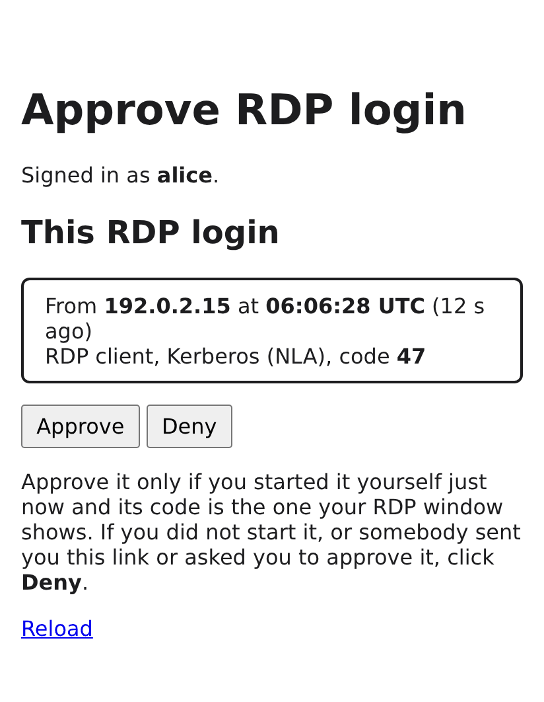

# fastrdp: building a multi-user Linux RDP terminal server from maintained parts

*One RDP front end with Kerberos SSO and MFA, a small broker, and the best native back-end for every Linux desktop, X11 and Wayland.*

Anyone who has run Windows Remote Desktop Services knows the experience: users open `mstsc`, are signed in with their domain account, and land in their own desktop on a shared server. Disconnect, reconnect from somewhere else, and the session is still there. I wanted the same for Linux. That became **fast-rdp-server**, or **fastrdp** for short ([GitHub](https://github.com/linuxrrze/fast-rdp-server)). This post covers the goal, the approaches I looked at, why I chose a hybrid design, what the second factor looks like for users, what works today, and what still needs testing on real hardware. It describes release **0.7.1** (October 2026), which is available from a signed APT repository.

## The goal

fastrdp aims to be a Windows-RDS-like **multi-user** terminal server for Linux:

- **Fast.** Use the GPU wherever possible, both for rendering and for H.264 encoding of the screen.
- **Single sign-on plus MFA.** Kerberos against the existing realm (Samba AD, FreeIPA or MIT). A second factor from privacyIDEA (push, TOTP/HOTP, YubiKey OTP) or an approval on a web page after a Keycloak sign-in with a passkey. Smartcards and YubiKey PIV for NLA logons. Keycloak for browser access.
- **Every common desktop, X11 and Wayland.** Xfce, MATE, Cinnamon, LXQt and Plasma X11, but also GNOME 50 and Plasma 6 on Wayland, plus the wlroots compositors Sway, labwc and Wayfire.

One more constraint shaped everything else: **no new RDP stack.** fastrdp integrates maintained software and adds little glue: a session broker, a proxy module and Ansible.

## The landscape: four approaches

Before writing code, I looked at what the Linux RDP world offers today.


*Figure 1: What each approach covers. Green = covered, yellow = partly, red = not covered. The fastrdp column is implemented and tested in CI and a sandbox; the back-ends and GPU paths still need lab validation.*

### (a) xrdp alone

xrdp is the obvious starting point. Release 0.10.6.1 has the GFX pipeline with H.264, runs its daemon unprivileged and handles per-user X sessions well. But:

- **X11 only.** GNOME 50 and Plasma 6.8 are Wayland-only, and xorgxrdp cannot host them.
- **No NLA in any release.** There is a pull request for GSSAPI NLA (#3868), but it is not merged. More on that below, because it led me to an MIT Kerberos bug.
- **Software H.264 only.** x264 or OpenH264 on the CPU. glamor gives GPU *rendering*, but encoding still costs about a core or more per active 1080p session.
- MFA is only possible through PAM at xrdp's own login dialog.

Also, Debian 13 and Ubuntu 26.04 both ship **xrdp 0.10.1**: no H.264, no unprivileged daemon, and the 19 CVE fixes of 0.10.5–0.10.6.1 only as far as backported.

### (b) Each desktop's native RDP server

GNOME and KDE now have their own RDP servers, and they are good at what they do:

- **gnome-remote-desktop** supports headless logins through GDM, NLA with a Kerberos keytab, and hardware H.264 through VA-API or NVENC.
- **KRdp** (FreeRDP + PipeWire) encodes with VA-API. Officially it only shares an *existing* Plasma session.

Using them on their own means two separate servers with separate configuration and no common place for MFA. Nothing covers the X11 desktops, and the wlroots compositors have no RDP server at all. Their only exporter is **wayvnc**, and a VNC hop would lose H.264 and the GPU path.

### (c) The ogon model

ogon got the architecture right years ago: a broker sits in front of per-user sessions and decides where each login goes. Unfortunately the project has been dormant since about 2019. I didn't try to revive it, but its broker model is the direct inspiration for fastrdp.

### (d) The hybrid I chose

fastrdp combines the ogon idea with today's maintained components:

1. **One RDP front end.** `freerdp-proxy` from FreeRDP 3 terminates TLS and NLA, plus a small C module that asks the broker before letting anyone in.
2. **A session broker.** `fastrdp-brokerd` is a small Python daemon (standard library only). It checks the account, enforces MFA, picks the desktop and starts or reuses the user's session.
3. **Native back-ends per desktop family**, each listening on loopback only:
   - X11 desktops through **xrdp 0.10.6.1 + xorgxrdp**;
   - GNOME through a **GDM headless session + gnome-remote-desktop**;
   - Plasma 6 through **KWin's virtual backend + KRdp**;
   - Sway, labwc and Wayfire **nested inside an xrdp session**, using wlroots' X11 backend.

The point: authentication happens **once, in one place** (NLA, Kerberos, smartcards and MFA at the proxy and broker), whatever the desktop. And each desktop gets its **best encoder**: g-r-d's VA-API/NVENC for GNOME, KPipeWire's VA-API for Plasma, and, for X11, a hardware encoder I added to xrdp myself.

## Architecture and login flow

![Architecture overview: RDP clients and a browser or phone connect to the RDP host; freerdp-proxy with the fastrdp module talks to fastrdp-brokerd and draws the waiting screen and desktop picker into the RDP window; the broker gets the second factor from KDC evidence, a privacyIDEA push or a web approval on fastrdp-webgate, which signs users in at Keycloak and sends opt-in notifications through ntfy and Web Push services; xrdp, GNOME and Plasma back-ends run on loopback behind nftables; Kerberos KDC, Keycloak and privacyIDEA are external](diagrams/02-architecture-overview.png)
*Figure 2: Architecture overview. Only port 3389 (and 443 for the optional web gateway) is reachable from the network. The second factor comes from KDC evidence in the ticket, a privacyIDEA push or an approval on the web gateway.*

A login goes like this:

1. The client (mstsc, xfreerdp3, Remmina) gets a Kerberos service ticket for `TERMSRV/<fqdn>` and connects to the proxy with **NLA**. The proxy accepts only Kerberos. NTLM is refused, because the proxy has no way to check domain passwords that way. Windows mstsc uses Kerberos *user-to-user* here, which needed a FreeRDP patch to work with Active Directory (more below).
2. The module reads the authenticated principal and sends a `login` request to the broker over a Unix socket.
3. The broker runs the PAM account phase (SSSD, including the AD GPO "Allow log on through Remote Desktop Services"), checks groups and runs **MFA**. NLA has no field for an OTP, so NLA logins use a **privacyIDEA push** or an **approval on the web gateway** (or both, whichever answers first); meanwhile the proxy draws a waiting screen into the RDP window (see below). Because the broker never sees a password with Kerberos single sign-on, it triggers the push through a privacyIDEA service account with the `triggerchallenge` right. Clients without Kerberos can use TLS with password plus appended OTP (TOTP or YubiKey OTP). Smartcard or Windows Hello for Business logons can count as MFA on their own: the proxy's FreeRDP keeps the KDC's evidence from the ticket (authentication indicators, PAC SIDs), and the broker can skip the second factor for matching logins.
4. The broker picks the desktop: the client hint `fastrdp:<desktop>` in the RDP *alternate shell* field, then (optionally) the user's pick in a desktop picker drawn into the RDP window, then a choice stored on the web gateway's chooser page, then `~/.config/fastrdp/desktop`, then a group default, then the global default. mstsc and the Windows App have no field for the hint, which is why the picker and the stored choice exist.
5. It starts or reuses the session and returns a loopback target plus credentials:
   - **xrdp:** a **one-time token** (60 s, single use, bound to the user). xrdp-sesman's PAM stack accepts nothing else, so xrdp can't bypass MFA. If the proxy learned the real password, the token module passes it to `pam_sss` and X11 sessions get a Kerberos TGT.
   - **GNOME:** g-r-d headless with a random per-session secret, started via GDM's `gnome-headless-session@USER`.
   - **Plasma:** `fastrdp-plasma@USER` runs `kwin_wayland --virtual` and `krdpserver` on a per-user loopback port.
6. The proxy connects to the back-end with the broker's credentials and relays the session. GFX/H.264 is passed through without being decoded, and so are the other channels. Sound and microphone, for example, are handled in the session: xrdp, wlroots and GNOME sessions get PipeWire with `pipewire-module-xrdp` or `pipewire-pulse` (implemented, not yet tested with real clients); KRdp has no audio, so Plasma users who need sound use `plasma-x11`. On disconnect the session keeps running, and the next login reconnects to it.

![Sequence diagram of a Kerberos NLA login: the client gets a ticket from the KDC (mstsc: user-to-user) and connects to the proxy; the broker checks the account; KDC evidence, an exempt group or reconnect grace skips the second factor, otherwise the proxy shows the waiting screen with login code, QR code and countdown while the broker waits for a privacyIDEA push or a web approval (the phone scans the QR code, signs in at Keycloak with a passkey and approves on the webgate, which calls mfa_decide; optionally a ntfy or Web Push notification first); optionally the user picks the desktop in the RDP window; the broker starts or reuses the back-end and returns a loopback target, and the proxy connects with swapped credentials](diagrams/03-login-sequence.png)
*Figure 3: The login sequence for an RDP client with Kerberos NLA: the second factor by MFA mode (KDC evidence, privacyIDEA push, web approval), the optional desktop picker, then the session start. The waiting screen and the approval page follow further below.*

### The browser path

For users without an RDP client there is an optional web path. The browser logs in at **Keycloak** (OIDC with PKCE). MFA happens there (passkeys, OTP, WebAuthn/FIDO2 or the privacyIDEA provider), and the webgate checks the `acr`/`amr` claims to prove it. Ansible can set up the Keycloak flow for passkeys so that a passkey sign-in yields `acr=mfa` (`fastrdp_web_passkeys`, tested against Keycloak 26.8.1); a sign-in without that proof gets a clear "Second factor required" page instead of a desktop. The webgate then asks the broker for a single-use **web token** and hands Guacamole an encrypted, signed connection blob that is valid for 30 seconds. guacd connects to the proxy with that token like any other client.


*Figure 4: The optional web gateway: the browser path through Keycloak and Guacamole, the approval page and notifications for RDP logins, and the stored desktop choice and .rdp files for RDP apps.*

It's a convenience path. guacd re-encodes the screen as images, so there is no H.264 to the browser, and sessions get no Kerberos ticket because no password ever reaches the server.

The same web gateway also serves the RDP apps: its chooser page lets users store the desktop their mstsc logins get, or download an `.rdp` file for one desktop. And it hosts the approval page for RDP logins, which brings us to the second factor.

## The second factor, from the user's side

For users, the second factor is the part of fastrdp they meet every day. NLA has no prompt for a code, and with Kerberos single sign-on there is no password dialog either: the client connects, and then the login waits for the push or the approval. The first test with a real Windows client showed what that looks like without help: a black window. So the proxy now tells the user what is going on.

### The waiting screen

While the broker works on a login, the proxy module paints a panel into the RDP window. It uses plain Bitmap Updates, the one kind of graphics output every RDP client must accept at that stage, so there is no client plugin and no client setting. The panel shows "Signing you in…", then what to do for the second factor with a countdown, and finally "Connecting to your desktop…". For web approval it adds the approval URL, a two-digit **login code** and a **QR code** for the phone. English and German texts are built in and chosen from the client's keyboard layout; admins can override them per language. It has been on by default since 0.7.0.


*Figure 5: The waiting screen in the RDP window, here for push or web approval. Rendered with the proxy module's own drawing code and example data.*

### Approving the login

Which second factor is due depends on the MFA mode: `none`, `otp` (appended to the password, TLS logins only), `push`, `otp_or_push`, `web`, or `push_or_web`, where whichever answer comes first wins. In practice that means:

- **privacyIDEA push:** confirm the notification in the privacyIDEA app, as before.
- **Web approval:** scan the QR code in the RDP window with the phone (or type the short URL shown there), sign in at Keycloak with a passkey, security key or authenticator app, and click **Approve**. The approval page shows the login's client address, start time and the same login code as the RDP window. Nothing is needed on the client, so it works the same for mstsc, xfreerdp3 and Remmina (with mstsc, so far without a full lab run; see the status below).
- **Notifications** (opt-in on `/web/notify`): users who turn them on get a message on their phone or in their browser the moment a login waits, through **ntfy** (also on Android phones without Google services) or **Web Push** (desktop browsers, Android, and iPhone/iPad as a home-screen web app). The notification is only a hint: it links to the plain approval page and approves nothing.


*Figure 6: The approval page, opened from the QR code: same login code, client address and start time.*

A few details make this harder to abuse than "click yes on whatever pops up":

- **The QR code is bound to this login.** It encodes the approval URL plus the broker's random id of exactly this pending login. Someone who has the password and starts a login at the same moment gets a different id, which only their own screen shows. Scanning the code in your own RDP window can only approve your own login.
- **The login code ties the three places together.** RDP window, approval page and notification show the same two-digit code, so the user can check that the login on the page is the one on their screen. It's a bit like number matching in push apps, except that you compare instead of type.
- **A warning when several logins wait.** If the page was opened from the QR code while other logins of the same account are pending, it puts a red box above the buttons: how many logins wait, this login's code in large type, and "approve only if your own RDP window shows this code". The other logins can only be denied from there, and the approval is logged with a warning.
- **Every approval needs a fresh MFA sign-in.** The page sends the user to Keycloak with `prompt=login` and `max_age=0` and checks `auth_time`, so an existing browser session doesn't count, and the id in the link is no credential on its own. A sign-in that doesn't prove MFA ends on a "Second factor required" page.


*Figure 7: The same page while a second login of the account waits.*

None of this stops a user who approves a login they didn't start, which is still the weak spot of every push-style factor. But it gives them a fair chance to notice. If the KDC has already proven a strong logon (smartcard, Windows Hello for Business, see above), there is no second prompt at all.

### Choosing the desktop in the RDP window

The same panel can also ask for the desktop. With the opt-in desktop picker, users who may use more than one desktop choose after the second factor, with a digit, the arrow keys and Enter, or a click; a countdown starts the preselected one. Logins that already name a desktop, and users with only one, never see it. This needed one more FreeRDP patch, because the proxy has to read the client's input while it still waits for the broker.


*Figure 8: The optional desktop picker after the second factor.*

**Status:** the waiting screen, the QR code and the picker are tested end to end with FreeRDP clients through the real proxy; the test decodes the QR code from the client's screen. With mstsc and the Windows App they still have to be confirmed in a lab: panel visible, countdown updating, QR code scannable, nothing left over when the desktop appears. Web approval with a real Keycloak and mstsc together is a lab item, too. Notifications are checked against the RFC test vectors and local servers, but not yet on real iOS and Android devices.

## Performance and the GPU

### Rendering and encoding per back-end


*Figure 9: Which part uses the GPU where. This is derived from upstream sources and sandbox tests; it still has to be confirmed on real Intel, AMD and NVIDIA hosts.*

- **X11 (xrdp):** glamor renders on Intel/AMD. On NVIDIA, GL applications use VirtualGL (`vglrun`). Upstream xrdp only encodes in software, so I wrote an **FFmpeg encoder backend for xrdp 0.10.6.1**. It encodes the NV12 frames xorgxrdp already produces with `h264_vaapi` (Intel/AMD), `h264_nvenc` (NVIDIA) or `h264_qsv`, tuned for low latency. A start-up probe encodes one test frame; if the GPU, driver or library is unusable, xrdp logs a warning and falls back to libx264, so it is never worse than the unpatched build.
- **GNOME:** Mutter renders on the GPU. g-r-d encodes with VA-API (through Vulkan) or NVENC. It has no software H.264, so without a GPU it falls back to RFX progressive at much higher bandwidth.
- **Plasma:** KWin renders on the GPU. KPipeWire tries `h264_vaapi`, then libx264, then libopenh264. It never tries NVENC, so on NVIDIA hosts Plasma sessions encode on the CPU.
- **wlroots desktops** inherit the xrdp path. They render with GLES when the X server offers DRI3, otherwise with pixman.

One trap worth knowing: **Ubuntu 26.04's FreeRDP 3.32.1 is built without H.264**, so the distribution's `xfreerdp3` falls back to RFX at 5–10× the bandwidth. That's one reason fastrdp builds its own FreeRDP, more on that below.

### What the proxy costs

A single front end only works if it is cheap. `tests/perf/proxy-overhead.sh` compares a direct connection with one through freerdp-proxy and the fastrdp module. Back-end: a FreeRDP shadow server on Xvfb at 1920×1080, on a busy shared AMD Ryzen 7 7735HS; codec RFX, because that FreeRDP build has no H.264 encoder.

| Load | Path | fps (3 runs) | GFX Mbit/s | proxy CPU (1 core = 100 %) |
|---|---|---|---|---|
| video 1280×720 | direct | 24.6 / 26.8 / 28.2 | 34–39 | – |
| video 1280×720 | proxy | 25.8 / 25.2 / 31.9 | 34–44 | 17–18 % |
| scroll full screen | direct | 30.3 / 31.2 / 31.9 | 171–185 | – |
| scroll full screen | proxy | 31.9 / 31.9 / 31.9 | 185 | 48–50 % |

The results:

- The proxy costs **no frame rate**.
- Its effect on input-to-frame latency is below the noise of that host (about ±10 ms).
- Its CPU cost scales with bandwidth, at about **0.3–0.5 % of one core per Mbit/s**, because it decrypts and re-encrypts TLS. At typical H.264 rates of 5–20 Mbit/s per session, that's 2–10 % of a core.

These are sandbox numbers without a GPU. GPU measurements are next; the runbook and tools (`rdpbench`, `perfload`, `session_report.py`) are in the repository.

## Security notes

Some decisions I'd like to highlight (the code has also been through several review rounds; the findings are fixed and covered by regression tests):

- **Only the proxy is exposed.** Back-end ports are dropped on non-loopback interfaces. On loopback, an nftables owner rule (`meta skuid`) lets only the proxy user and root open connections. Before routing, the broker checks in `/proc/net/tcp` that the target port is held by exactly the expected uid, so a user can't grab a back-end port and collect credentials. Since 0.5.1 the proxy also pins each back-end's TLS certificate: the broker names the expected SHA-256 fingerprint, and any other certificate ends the login.
- **One-time tokens instead of passwords** towards xrdp: 60 s, single use, kept in memory only. The client's password never travels over the RDP hop to xrdp.
- **The smartcard PIN is never forwarded.** Testing smartcard logon (PKINIT) end to end showed that FreeRDP stores the card PIN in the password setting, and the module forwarded it: the PIN could have reached `pam_sss` (AD lockout counts) or privacyIDEA. The module now checks `PasswordIsSmartcardPin`, the broker drops passwords on smartcard logins, and a regression test covers it.
- **Unprivileged daemons.** The xrdp daemon runs as user `xrdp`, including the hardware encoder. The proxy runs as `_fastrdp-proxy`. GNOME and Plasma back-ends run as the user.
- **One user can't shut down the shared host.** RDP sessions have no seat, so polkit would let users shut down or reboot the host with an admin's password. A polkit rule now refuses the power actions in RDP sessions; only members of an admin group can still authenticate for them.

## How it's built

### Vendored, patched dependencies

fastrdp builds two dependencies itself instead of using the distribution packages:

- **FreeRDP 3.32.2** in a private prefix, `/opt/fastrdp`, with seven fastrdp patches. The proxy needs FreeRDP ≥ 3.32, and Debian 13 ships 3.15.0. This also gives one tested version on both distributions, and H.264 in fastrdp's own clients. The patches fix the smartcard slot id, let mstsc's Kerberos user-to-user work with AD, handle Remote Credential Guard requests cleanly, keep the KDC's evidence from the ticket, and let the proxy read input for the desktop picker. g-r-d and KRdp keep the distribution's FreeRDP.
- **xrdp 0.10.6.1 + xorgxrdp 0.10.5**, because the distributions ship 0.10.1, and because the FFmpeg encoder patch lives there.

One file, `third_party/sources.yml`, pins version, URL, sha256 and patch series. The Ansible build path, the packages and CI all use the same scripts, so the patch set can't drift. Each patch has a README explaining why it is needed and when it can be dropped.

### Upstream findings

Several bugs that belong to other projects came out of this work. Three examples:

- **MIT krb5 SPNEGO regression.** Kerberos NLA from default FreeRDP clients to xrdp's NLA pull request failed with "Invalid token was supplied". I traced it to MIT krb5 1.21.0–1.22.1: FreeRDP offers Kerberos user-to-user first, so MIT must check the client's mechListMIC, and since commit fdceb225 it looks for it under ASN.1 tag `0xA4` instead of `0xA3`. MIT had already fixed this in **1.22.2** (ticket 9183), but Debian 13 and Ubuntu 26.04 ship affected versions. fastrdp isn't affected (freerdp-proxy uses WinPR's SPNEGO), which is one more reason NLA stays at the proxy.
- **FreeRDP PKCS#11 slot id truncated to 16 bits.** The client formats the slot id as `UINT16`, so PKCS#11 modules with 32-bit slot ids (SoftHSM2, some HSMs) fail smartcard logon. The fix is four lines. OpenSC and YubiKey PIV use small slot ids and are not affected.
- **FreeRDP's Kerberos user-to-user acceptor and Active Directory.** mstsc always starts Kerberos under CredSSP with a user-to-user request. WinPR's acceptor then asks the KDC for a TGT of `TERMSRV/<host>`, which AD refuses, so every mstsc Kerberos login to an AD-joined FreeRDP server failed. fastrdp's patch answers with the machine account's TGT from the keytab. Confirmed in the field: two Windows clients logged in with mstsc and Kerberos through the proxy of an AD-joined host.

Reports and pull request texts, including one for the xrdp encoder, are drafted in `docs/upstream.md`, and each FreeRDP patch has its reasoning in the repository. **Nothing has been submitted yet**; that happens once the stack works end to end.

### Tests and CI

The tests run in GitHub Actions, in `ubuntu:26.04` and `debian:trixie` containers:

- **Unit and protocol tests** for the broker (521 tests, including regression tests for review findings), the webgate, the PAM module and the GPU report.
- **End-to-end tests against a real freerdp-proxy** with the module and the vendored FreeRDP: TLS, Kerberos NLA against a throwaway KDC (including the user-to-user path and the KDC evidence), smartcard PKINIT (the SoftHSM variant guards the slot id fix), back-end certificate pinning, and the waiting screen and desktop picker as a client sees them.
- **The xrdp encoder test** runs the FFmpeg backend with libx264 through the same code path (30 of 30 frames decode, luma PSNR 56 dB at QP 20) and checks the VA-API/NVENC fallback.
- Ansible template rendering, ansible-lint, shellcheck, lintian and an install test of all packages.


*Figure 10: One source of truth for the vendored builds, three consumers, and the CI pipeline that publishes the APT repository.*

### Packages and license

There are Debian/Ubuntu packages for fastrdp and the two vendored builds. CI publishes them as a **signed APT repository on GitHub Pages**, [linuxrrze.github.io/fast-rdp-server](https://linuxrrze.github.io/fast-rdp-server/), with a stable suite (release tags, currently 0.7.1) and a testing suite (the main branch) each for Ubuntu 26.04 and Debian 13. Ansible can install from it or compile on the host.

fastrdp's own code is **Apache-2.0**. The vendored FreeRDP and xrdp binaries link the distributions' GPL-2.0-or-later FFmpeg and x264, so they are distributed under **GPL-3.0-or-later** terms. CI archives the exact build tree, and publishing refuses a vendored package without its corresponding source.

## Status and roadmap

**Working and tested in CI or a sandbox:** the broker with all MFA modes, the proxy module end to end in a real freerdp-proxy (TLS, Kerberos NLA, smartcard, waiting screen, desktop picker), the PAM token module, the web path's token and crypto flow, the web approval and notification code, Keycloak's passkey flow against a real Keycloak 26.8.1, the Ansible roles, the wlroots launcher on Xvfb, the xrdp encoder via libx264 and its fallback, packaging and CI.

**Confirmed in the field:** Windows mstsc logs in with Kerberos NLA through the proxy of an AD-joined host (user-to-user, two Windows clients). First deployments on real hosts also turned up a few Ansible problems, which are fixed in 0.6.1 and 0.7.0.

**Needs validation on real hardware or a real lab:**

- **GPU encoding on real Intel, AMD and NVIDIA hardware**, for all back-ends, including my xrdp patch. Until then, size CPUs for x264.
- **The GNOME and Plasma headless back-ends on a lab host.** Headless KRdp is unofficial, and no real GNOME or Plasma session has been started yet. Full xrdp sessions through the proxy also need a lab run.
- **Windows clients beyond the Kerberos login:** the waiting screen, QR code and desktop picker in mstsc and the Windows App, web approval with a real Keycloak, and real smartcards with an AD PKI. Smartcard logon so far works with a software token. Skipping the second factor based on the KDC's evidence (smartcard, Windows Hello for Business) is implemented but needs a real AD to confirm which SIDs these logons carry. From the code, mstsc can only use Kerberos when it connects by FQDN or short name and gets AES tickets; connecting by IP address falls back to NTLM, which the proxy refuses.
- **Audio and microphone** with real clients, and **notifications** on real iOS and Android devices.
- **The guided setup assistant** (`make setup`, `make preflight`) in a systematic lab run.

**Deferred for now:** seamless application windows (RemoteApp), because none of the back-ends can serve them today, and Windows hosts as back-ends, which would put fastrdp's MFA in front of real Windows RDP servers but means relaying clear-text domain passwords. Both are researched and written up in the backlog, should someone need them.

To try it in a lab, the [quick start](https://github.com/linuxrrze/fast-rdp-server/blob/main/docs/quickstart.md) walks through four steps: answer about 15 questions, run the read-only preflight, deploy, then run the smoke test and connect:

```sh
make setup                          # guided: writes ansible/inventories/<name>/
make preflight INVENTORY=<name>     # read-only checks of the target
make deploy INVENTORY=<name>        # ansible-playbook site.yml
xfreerdp3 /v:rdp1.lab.example.com /u:alice /d:LAB.EXAMPLE.COM /sec:nla /gfx:avc444
```

The target is a fresh Ubuntu 26.04 or Debian 13 host joined to Samba AD or FreeIPA (or an MIT KDC with a keytab you provide). If you don't have a directory yet, the quick start shows how to set up a Samba AD DC in a second VM.

## Help wanted

The remaining questions can only be answered on real systems. I'd especially welcome:

- **Testers with GPUs**: Intel and AMD with VA-API, NVIDIA with NVENC. The runbook in `docs/performance.md` and `tests/gpu/session_report.py` show what to measure.
- **Windows/AD labs**: mstsc and the Windows App with the waiting screen, web approval and the desktop picker, AD GPOs, smartcard and Windows Hello for Business logons with a real PKI.
- **Phones**: approval notifications through ntfy and Web Push on iOS and Android.
- **GNOME and Plasma users** who want to try the headless back-ends.
- **Feedback on the design**: the broker, the token handoff, and the decision to keep NLA at the proxy.

The project is on GitHub: **[linuxrrze/fast-rdp-server](https://github.com/linuxrrze/fast-rdp-server)**. Issues, test reports and pull requests are welcome.
