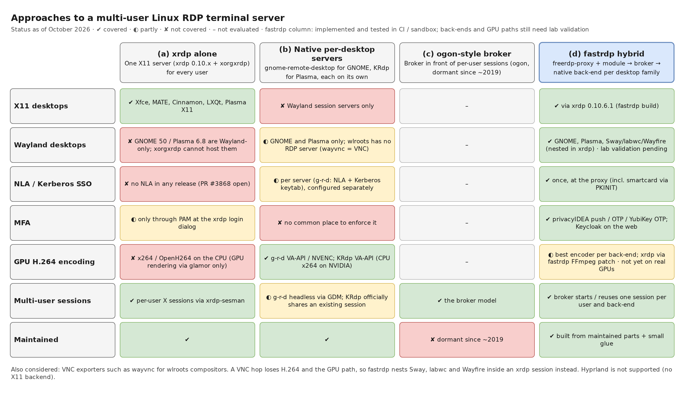
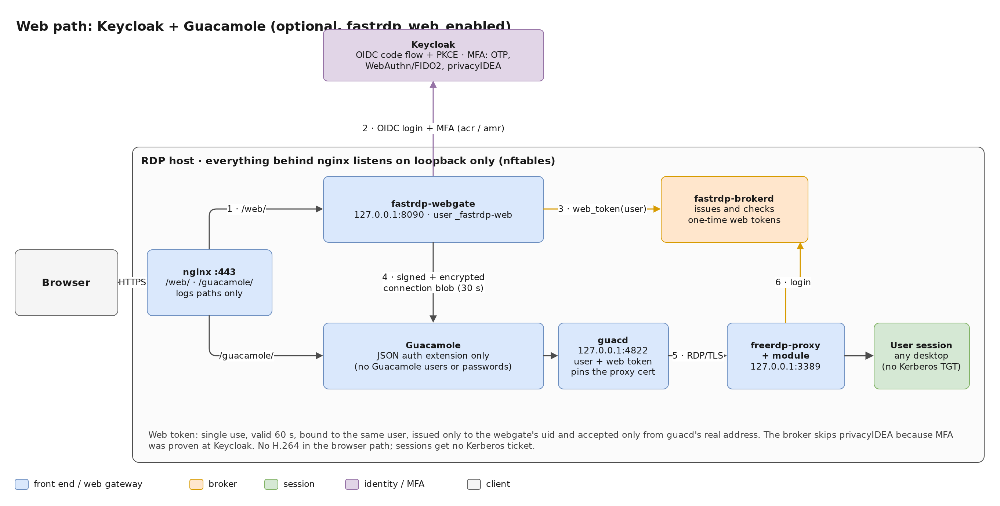

# fastrdp: building a multi-user Linux RDP terminal server from maintained parts

*One RDP front end with Kerberos SSO and MFA, a small broker, and the best native back-end for every Linux desktop, X11 and Wayland.*

Anyone who has run Windows Remote Desktop Services knows the experience: users open `mstsc`, are signed in with their domain account, and land in their own desktop on a shared server. Disconnect, reconnect from somewhere else, and the session is still there. I wanted the same for Linux. That became **fast-rdp-server**, or **fastrdp** for short ([GitHub](https://github.com/linuxrrze/fast-rdp-server)). This post covers the goal, the approaches I looked at, why I chose a hybrid design, what works today, and what still needs testing on real hardware.

## The goal

fastrdp aims to be a Windows-RDS-like **multi-user** terminal server for Linux:

- **Fast.** Use the GPU wherever possible, both for rendering and for H.264 encoding of the screen.
- **Single sign-on plus MFA.** Kerberos against the existing realm (Samba AD, FreeIPA or MIT). A second factor from privacyIDEA: push, TOTP/HOTP, YubiKey OTP. Smartcards and YubiKey PIV for NLA logons. Keycloak for browser access.
- **Every common desktop, X11 and Wayland.** Xfce, MATE, Cinnamon, LXQt and Plasma X11, but also GNOME 50 and Plasma 6 on Wayland, plus the wlroots compositors Sway, labwc and Wayfire.

One more constraint shaped everything else: **no new RDP stack.** fastrdp integrates maintained software and adds little glue: a session broker, a proxy module and Ansible.

## The landscape: four approaches

Before writing code, I looked at what the Linux RDP world offers today.


*Figure 1: What each approach covers. Green = covered, yellow = partly, red = not covered. The fastrdp column is implemented and tested in CI and a sandbox; the back-ends and GPU paths still need lab validation.*

### (a) xrdp alone

xrdp is the obvious starting point. Release 0.10.6.1 has the GFX pipeline with H.264, runs its daemon unprivileged and handles per-user X sessions well. But:

- **X11 only.** GNOME 50 and Plasma 6.8 are Wayland-only, and xorgxrdp cannot host them.
- **No NLA in any release.** There is a pull request for GSSAPI NLA (#3868), but it is not merged. More on that below, because it led me to an MIT Kerberos bug.
- **Software H.264 only.** x264 or OpenH264 on the CPU. glamor gives GPU *rendering*, but encoding still costs about a core or more per active 1080p session.
- MFA is only possible through PAM at xrdp's own login dialog.

Also, Debian 13 and Ubuntu 26.04 both ship **xrdp 0.10.1**: no H.264, no unprivileged daemon, and the 19 CVE fixes of 0.10.5–0.10.6.1 only as far as backported.

### (b) Each desktop's native RDP server

GNOME and KDE now have their own RDP servers, and they are good at what they do:

- **gnome-remote-desktop** supports headless logins through GDM, NLA with a Kerberos keytab, and hardware H.264 through VA-API or NVENC.
- **KRdp** (FreeRDP + PipeWire) encodes with VA-API. Officially it only shares an *existing* Plasma session.

Using them on their own means two separate servers with separate configuration and no common place for MFA. Nothing covers the X11 desktops, and the wlroots compositors have no RDP server at all. Their only exporter is **wayvnc**, and a VNC hop would lose H.264 and the GPU path.

### (c) The ogon model

ogon got the architecture right years ago: a broker sits in front of per-user sessions and decides where each login goes. Unfortunately the project has been dormant since about 2019. I didn't try to revive it, but its broker model is the direct inspiration for fastrdp.

### (d) The hybrid I chose

fastrdp combines the ogon idea with today's maintained components:

1. **One RDP front end.** `freerdp-proxy` from FreeRDP 3 terminates TLS and NLA, plus a small C module that asks the broker before letting anyone in.
2. **A session broker.** `fastrdp-brokerd` is a small Python daemon (standard library only). It checks the account, enforces MFA, picks the desktop and starts or reuses the user's session.
3. **Native back-ends per desktop family**, each listening on loopback only:
   - X11 desktops through **xrdp 0.10.6.1 + xorgxrdp**;
   - GNOME through a **GDM headless session + gnome-remote-desktop**;
   - Plasma 6 through **KWin's virtual backend + KRdp**;
   - Sway, labwc and Wayfire **nested inside an xrdp session**, using wlroots' X11 backend.

The point: authentication happens **once, in one place** (NLA, Kerberos, smartcards and MFA at the proxy and broker), whatever the desktop. And each desktop gets its **best encoder**: g-r-d's VA-API/NVENC for GNOME, KPipeWire's VA-API for Plasma, and, for X11, a hardware encoder I added to xrdp myself.

## Architecture and login flow


*Figure 2: Architecture overview. Only port 3389 (and 443 for the optional web path) is reachable from the network.*

A login goes like this:

1. The client (mstsc, xfreerdp3, Remmina) gets a Kerberos service ticket for `TERMSRV/<fqdn>` and connects to the proxy with **NLA**. The proxy accepts only Kerberos. NTLM is refused, because the proxy has no way to check domain passwords that way.
2. The module reads the authenticated principal and sends a `login` request to the broker over a Unix socket.
3. The broker runs the PAM account phase (SSSD, including the AD GPO "Allow log on through Remote Desktop Services"), checks groups and runs **MFA**. NLA has no field for an OTP, so NLA logins use a **privacyIDEA push**; the client shows "connecting…" until it is confirmed. Clients without Kerberos can use TLS with password plus appended OTP (TOTP or YubiKey OTP).
4. The broker picks the desktop: the client hint `fastrdp:<desktop>` in the RDP *alternate shell* field, then `~/.config/fastrdp/desktop`, then a group default, then the global default.
5. It starts or reuses the session and returns a loopback target plus credentials:
   - **xrdp:** a **one-time token** (60 s, single use, bound to the user). xrdp-sesman's PAM stack accepts nothing else, so xrdp can't bypass MFA. If the proxy learned the real password, the token module passes it to `pam_sss` and X11 sessions get a Kerberos TGT.
   - **GNOME:** g-r-d headless with a random per-session secret, started via GDM's `gnome-headless-session@USER`.
   - **Plasma:** `fastrdp-plasma@USER` runs `kwin_wayland --virtual` and `krdpserver` on a per-user loopback port.
6. The proxy connects to the back-end with the broker's credentials and relays the session. GFX/H.264 is passed through without being decoded. On disconnect the session keeps running, and the next login reconnects to it.


*Figure 3: The login sequence for an RDP client with Kerberos NLA.*

### The browser path

For users without an RDP client there is an optional web path. The browser logs in at **Keycloak** (OIDC with PKCE). MFA happens there (OTP, WebAuthn/FIDO2 or the privacyIDEA provider), and the webgate checks the `acr`/`amr` claims to prove it. The webgate then asks the broker for a single-use **web token** and hands Guacamole an encrypted, signed connection blob that is valid for 30 seconds. guacd connects to the proxy with that token like any other client.


*Figure 4: The optional web path through Keycloak and Guacamole.*

It's a convenience path. guacd re-encodes the screen as images, so there is no H.264 to the browser, and sessions get no Kerberos ticket because no password ever reaches the server.

## Performance and the GPU

### Rendering and encoding per back-end


*Figure 5: Which part uses the GPU where. This is derived from upstream sources and sandbox tests; it still has to be confirmed on real Intel, AMD and NVIDIA hosts.*

- **X11 (xrdp):** glamor renders on Intel/AMD. On NVIDIA, GL applications use VirtualGL (`vglrun`). Upstream xrdp only encodes in software, so I wrote an **FFmpeg encoder backend for xrdp 0.10.6.1**. It encodes the NV12 frames xorgxrdp already produces with `h264_vaapi` (Intel/AMD), `h264_nvenc` (NVIDIA) or `h264_qsv`, tuned for low latency. A start-up probe encodes one test frame; if the GPU, driver or library is unusable, xrdp logs a warning and falls back to libx264, so it is never worse than the unpatched build.
- **GNOME:** Mutter renders on the GPU. g-r-d encodes with VA-API (through Vulkan) or NVENC. It has no software H.264, so without a GPU it falls back to RFX progressive at much higher bandwidth.
- **Plasma:** KWin renders on the GPU. KPipeWire tries `h264_vaapi`, then libx264, then libopenh264. It never tries NVENC, so on NVIDIA hosts Plasma sessions encode on the CPU.
- **wlroots desktops** inherit the xrdp path. They render with GLES when the X server offers DRI3, otherwise with pixman.

One trap worth knowing: **Ubuntu 26.04's FreeRDP 3.32.1 is built without H.264**, so the distribution's `xfreerdp3` falls back to RFX at 5–10× the bandwidth. That's one reason fastrdp builds its own FreeRDP, more on that below.

### What the proxy costs

A single front end only works if it is cheap. `tests/perf/proxy-overhead.sh` compares a direct connection with one through freerdp-proxy and the fastrdp module. Back-end: a FreeRDP shadow server on Xvfb at 1920×1080, on a busy shared AMD Ryzen 7 7735HS; codec RFX, because that FreeRDP build has no H.264 encoder.

| Load | Path | fps (3 runs) | GFX Mbit/s | proxy CPU (1 core = 100 %) |
|---|---|---|---|---|
| video 1280×720 | direct | 24.6 / 26.8 / 28.2 | 34–39 | – |
| video 1280×720 | proxy | 25.8 / 25.2 / 31.9 | 34–44 | 17–18 % |
| scroll full screen | direct | 30.3 / 31.2 / 31.9 | 171–185 | – |
| scroll full screen | proxy | 31.9 / 31.9 / 31.9 | 185 | 48–50 % |

The results:

- The proxy costs **no frame rate**.
- Its effect on input-to-frame latency is below the noise of that host (about ±10 ms).
- Its CPU cost scales with bandwidth, at about **0.3–0.5 % of one core per Mbit/s**, because it decrypts and re-encrypts TLS. At typical H.264 rates of 5–20 Mbit/s per session, that's 2–10 % of a core.

These are sandbox numbers without a GPU. GPU measurements are next; the runbook and tools (`rdpbench`, `perfload`, `session_report.py`) are in the repository.

## Security notes

Some decisions I'd like to highlight:

- **Only the proxy is exposed.** Back-end ports are dropped on non-loopback interfaces. On loopback, an nftables owner rule (`meta skuid`) lets only the proxy user and root open connections. Before routing, the broker checks in `/proc/net/tcp` that the target port is held by exactly the expected uid, so a user can't grab a back-end port and collect credentials.
- **One-time tokens instead of passwords** towards xrdp: 60 s, single use, kept in memory only. The client's password never travels over the RDP hop to xrdp.
- **The smartcard PIN is never forwarded.** Testing smartcard logon (PKINIT) end to end showed that FreeRDP stores the card PIN in the password setting, and the module forwarded it: the PIN could have reached `pam_sss` (AD lockout counts) or privacyIDEA. The module now checks `PasswordIsSmartcardPin`, the broker drops passwords on smartcard logins, and a regression test covers it.
- **Unprivileged daemons.** The xrdp daemon runs as user `xrdp`, including the hardware encoder. The proxy runs as `_fastrdp-proxy`. GNOME and Plasma back-ends run as the user.

## How it's built

### Vendored, patched dependencies

fastrdp builds two dependencies itself instead of using the distribution packages:

- **FreeRDP 3.32.2** in a private prefix, `/opt/fastrdp`. The proxy needs FreeRDP ≥ 3.32, and Debian 13 ships 3.15.0. This also gives one tested version on both distributions, and H.264 in fastrdp's own clients. g-r-d and KRdp keep the distribution's FreeRDP.
- **xrdp 0.10.6.1 + xorgxrdp 0.10.5**, because the distributions ship 0.10.1, and because the FFmpeg encoder patch lives there.

One file, `third_party/sources.yml`, pins version, URL, sha256 and patch series. The Ansible build path, the packages and CI all use the same scripts, so the patch set can't drift. Each patch has a README explaining why it is needed and when it can be dropped.

### Upstream findings

Two bugs that belong to other projects came out of this work:

- **MIT krb5 SPNEGO regression.** Kerberos NLA from default FreeRDP clients to xrdp's NLA pull request failed with "Invalid token was supplied". I traced it to MIT krb5 1.21.0–1.22.1: FreeRDP offers Kerberos user-to-user first, so MIT must check the client's mechListMIC, and since commit fdceb225 it looks for it under ASN.1 tag `0xA4` instead of `0xA3`. MIT had already fixed this in **1.22.2** (ticket 9183), but Debian 13 and Ubuntu 26.04 ship affected versions. fastrdp isn't affected (freerdp-proxy uses WinPR's SPNEGO), which is one more reason NLA stays at the proxy.
- **FreeRDP PKCS#11 slot id truncated to 16 bits.** The client formats the slot id as `UINT16`, so PKCS#11 modules with 32-bit slot ids (SoftHSM2, some HSMs) fail smartcard logon. The fix is four lines. OpenSC and YubiKey PIV use small slot ids and are not affected.

Reports and pull request texts, including one for the xrdp encoder, are drafted in `docs/upstream.md`. **Nothing has been submitted yet**; that happens once the stack works end to end.

### Tests and CI

The tests run in GitHub Actions, in `ubuntu:26.04` and `debian:trixie` containers:

- **Unit and protocol tests** for the broker (127 tests, including regression tests for review findings), the webgate, the PAM module and the GPU report.
- **End-to-end tests against a real freerdp-proxy** with the module and the vendored FreeRDP: TLS, Kerberos NLA against a throwaway KDC, and smartcard PKINIT (the SoftHSM variant guards the slot id fix).
- **The xrdp encoder test** runs the FFmpeg backend with libx264 through the same code path (30 of 30 frames decode, luma PSNR 56 dB at QP 20) and checks the VA-API/NVENC fallback.
- Ansible template rendering, ansible-lint, shellcheck, lintian and an install test of all packages.


*Figure 6: One source of truth for the vendored builds, three consumers, and the CI pipeline that publishes the APT repository.*

### Packages and license

There are Debian/Ubuntu packages for fastrdp and the two vendored builds. CI is set up to publish them as a **signed APT repository on GitHub Pages** (stable and testing suites for Ubuntu 26.04 and Debian 13). Ansible can install from it or compile on the host.

fastrdp's own code is **Apache-2.0**. The vendored FreeRDP and xrdp binaries link the distributions' GPL-2.0-or-later FFmpeg and x264, so they are distributed under **GPL-3.0-or-later** terms. CI archives the exact build tree, and publishing refuses a vendored package without its corresponding source.

## Status and roadmap

**Working and tested in CI or a sandbox:** the broker, the proxy module end to end in a real freerdp-proxy (TLS, Kerberos NLA, smartcard), the PAM token module, the web path's token and crypto flow, the Ansible roles, the wlroots launcher on Xvfb, the xrdp encoder via libx264 and its fallback, packaging and CI.

**Needs validation on real hardware or a real lab:**

- **GPU encoding on real Intel, AMD and NVIDIA hardware**, for all back-ends, including my xrdp patch. Until then, size CPUs for x264.
- **The GNOME and Plasma headless back-ends on a lab host.** Headless KRdp is unofficial, and no real GNOME or Plasma session has been started yet. Full xrdp sessions through the proxy also need a lab run.
- **Windows mstsc with Kerberos** against fastrdp, as well as real smartcards with an AD PKI. Smartcard logon so far works with a software token.
- **The guided setup assistant** (`make setup`, `make preflight`) against a real target.

To try it in a lab, the [quick start](https://github.com/linuxrrze/fast-rdp-server/blob/main/docs/quickstart.md) walks through four steps: answer about 15 questions, run the read-only preflight, deploy, then run the smoke test and connect:

```sh
make setup                          # guided: writes ansible/inventories/<name>/
make preflight INVENTORY=<name>     # read-only checks of the target
make deploy INVENTORY=<name>        # ansible-playbook site.yml
xfreerdp3 /v:rdp1.lab.example.com /u:alice /d:LAB.EXAMPLE.COM /sec:nla /gfx:avc444
```

The target is a fresh Ubuntu 26.04 or Debian 13 host joined to Samba AD or FreeIPA (or an MIT KDC with a keytab you provide). If you don't have a directory yet, the quick start shows how to set up a Samba AD DC in a second VM.

## Help wanted

The remaining questions can only be answered on real systems. I'd especially welcome:

- **Testers with GPUs**: Intel and AMD with VA-API, NVIDIA with NVENC. The runbook in `docs/performance.md` and `tests/gpu/session_report.py` show what to measure.
- **Windows/AD labs**: mstsc with Kerberos SSO, AD GPOs, smartcard logon with a real PKI.
- **GNOME and Plasma users** who want to try the headless back-ends.
- **Feedback on the design**: the broker, the token handoff, and the decision to keep NLA at the proxy.

The project is on GitHub: **[linuxrrze/fast-rdp-server](https://github.com/linuxrrze/fast-rdp-server)**. Issues, test reports and pull requests are welcome.
