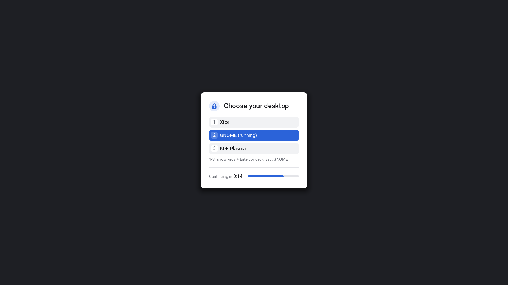

# Desktops, back-ends and GPU use

Per-back-end details (how sessions start, files, configuration, troubleshooting):
[backends/](backends/README.md).

Status legend:
- **verified** = tested in this repository (unit tests, build, or proxy end-to-end tests).
- **to validate** = written against upstream source/docs; needs a lab run on real hardware.

| Desktop (`fastrdp_desktops`) | Back-end | Display server | Rendering | Video encoding to client | Status |
|---|---|---|---|---|---|
| `xfce` | xrdp | Xorg + xorgxrdp | glamor on Intel/AMD; llvmpipe otherwise; VirtualGL for GL apps on NVIDIA | H.264 AVC420 via **VA-API/NVENC** (fastrdp FFmpeg patch) or **x264 (CPU)**, RFX fallback | to validate (xrdp build + configs verified to render) |
| `mate`, `cinnamon`, `lxqt` | xrdp | Xorg + xorgxrdp | as above | as above | to validate |
| `plasma-x11` | xrdp | Xorg + xorgxrdp | as above | as above | to validate; Plasma 6.6 on Ubuntu 26.04 still ships the X11 session |
| `gnome` (GNOME 50+, Wayland only) | gnome-remote-desktop headless, started via GDM `gnome-headless-session@USER` | Mutter headless | GPU via Mesa/NVIDIA GBM | H.264 via **VA-API or NVENC (GPU)**; without either: RFX progressive (g-r-d has no software H.264) | to validate |
| `plasma` (Plasma 6, Wayland) | KRdp (`krdpserver --plasma`) in a `kwin_wayland --virtual` session | KWin virtual backend | GPU via Mesa/NVIDIA GBM | H.264 via **VA-API** (Intel/AMD); **x264 on CPU on NVIDIA** (KPipeWire has no NVENC path) | to validate; **unofficial** headless mode (spike) |
| `sway`, `labwc`, `wayfire` (wlroots, Wayland) | xrdp; the compositor runs **nested** on the wlroots X11 backend inside the xorgxrdp display (`wlroots-in-x`) | Xorg + xorgxrdp, compositor fullscreen in one X window | GLES via glamor/DRI3 (Intel/AMD); pixman (software) otherwise | same as X11 desktops (VA-API/NVENC or x264) | launcher verified with Xvfb: start, resize to the X root size, clipboard both ways, restart over a stale socket (`tests/wlroots/run.sh`); full xrdp session to validate |
| Hyprland | – | – | – | – | not supported: Hyprland 0.53 (Aquamarine) has no X11 backend; would need a second nesting layer |

## wlroots desktops (Sway, labwc, Wayfire)

There is no maintained RDP server for wlroots compositors; wayvnc is the only
exporter, and a VNC hop would lose H.264 and the GPU path. Instead, the compositor
runs **inside** an ordinary xrdp session:

1. The broker routes the login to xrdp like any X11 desktop. The xsession entry
   `fastrdp-<compositor>` runs `/usr/libexec/fastrdp/wlroots-in-x <compositor>`.
2. The launcher starts the compositor with `WLR_BACKENDS=x11`, so it draws into
   one fullscreen window of the xorgxrdp display. xrdp still provides H.264/GFX,
   clipboard, drives, audio and reconnects (audio: the PipeWire xrdp module, which
   `wlroots-in-x` starts; see [backends/xrdp.md](backends/xrdp.md#channels)).
3. **Renderer:** GLES when the X server offers DRI3 (xorgxrdp-glamor on
   Intel/AMD); otherwise pixman. Wayfire's GL effects (cube, fisheye, …) need GLES.
4. **Size:** the launcher watches the X root size (dynamic resolution, reconnects)
   and sets the compositor's output with `wlr-randr --custom-mode`.
5. **Keyboard:** the compositor gets the X session's layout (`setxkbmap -query`)
   at start.
6. **Clipboard:** `clipboard-bridge` copies text both ways between X (the RDP
   clipboard channel) and the Wayland clipboard.
7. **Restarts:** the compositor's socket is identified from its own file
   descriptors, so stale `wayland-N` sockets from a crashed session are harmless.

Notes:
- Sway's default modifier is the Windows key, which many RDP clients keep for the
  local OS. Use the client's "send Windows key to remote" option or change `$mod` in
  `~/.config/sway/config`.
- Only text crosses the clipboard bridge.
- A keyboard layout change in the client needs a reconnect, which restarts the
  compositor.

## Choosing a desktop

Users get exactly one desktop per login. The broker picks it in this order:

1. Client hint: put `fastrdp:<desktop>` into the RDP *alternate shell* field
   - mstsc `.rdp`: `alternate shell:s:fastrdp:gnome` (the web gateway's chooser
     page downloads such a file, [web-access.md](web-access.md#rdp-apps))
   - xfreerdp3: `/shell:fastrdp:gnome`
2. The desktop chosen with **Use for Remote Desktop logins** on the web gateway's
   chooser page ([web-access.md](web-access.md#rdp-apps)). The broker keeps it in
   `/var/lib/fastrdp/desktop-prefs/<user>` (root only), not in the home directory, so
   it also works with Kerberized NFS homes. For mstsc and the Windows App, which have
   no desktop field of their own. Admins set it with `fastrdpctl desktop USER DESKTOP`
   and remove it with `fastrdpctl desktop USER --clear`.
3. `~/.config/fastrdp/desktop` containing the desktop name, e.g. `plasma`.
4. A group default from `fastrdp_group_desktops`.
5. `fastrdp_default_desktop`.

Each step counts only if the user may use that desktop (`fastrdp_desktop_groups`).
A choice from step 2 that is no longer allowed is skipped (broker log: `desktop …
chosen on the web gateway is not allowed (any more); ignored`) and kept: it applies
again once the user is back in the desktop's group.

`fastrdpctl desktop USER` (root) shows the stored choice, the user's
`~/.config/fastrdp/desktop`, the desktops the user may use and which desktop an RDP
login without a hint gets now and from which step (`--json` for the broker's reply):

```
user:                       alice
stored choice:              none
~/.config/fastrdp/desktop:  none (or not readable)
RDP logins get:             plasma (default of group rdp-kde; an allowed client hint fastrdp:<desktop> comes first)
allowed desktops:           xfce, gnome, plasma
```

`fastrdpctl desktop USER DESKTOP` refuses a desktop the user may not use and lists the
allowed ones.

A user can have one running session per back-end. Switching from `xfce` to `gnome`
starts a second session; the X11 one keeps running until logout or timeout.

### Desktop picker in the RDP window

With `fastrdp_desktop_picker` (broker `[broker] desktop_picker`) users who may use more
than one desktop pick it in the RDP window, after the second factor and before the
session starts. It works with any client (mstsc, Windows App, FreeRDP, Remmina) and
needs no client setting. Off by default.

```
Choose your desktop

 [1] Xfce
 [2] GNOME (running)          <- preselected, accent-filled
 [3] KDE Plasma
 [4] MATE (opens the running Xfce)
1-4, arrow keys + Enter, or click. Esc: GNOME

Continuing in 0:09
```



Keys 1-9 (top row, or the numeric keypad with NumLock) start a desktop at once; Up/Down
(Tab, Home, End) move the selection and Enter starts it; a click on a row starts that
row; Esc starts the preselected one. When the countdown (`fastrdp_desktop_picker_timeout`,
10 s, at most 60) runs out, the selected row starts: the preselected one unless the user
moved the selection. Keys typed before the picker showed (during the MFA wait) do not
count.

| `fastrdp_desktop_picker` | The picker is shown |
|---|---|
| `never` (default) | never; the order above decides |
| `if_multiple` | when the order above ends at step 4 or 5: the user has chosen nothing yet (no stored choice, no `~/.config/fastrdp/desktop`) |
| `always` | also when the user has; the stored choice is preselected |

In every mode the picker is left out
- for a login that names a desktop (step 1; any *alternate shell* counts). The web
  gateway and its downloaded `.rdp` files always name one, so browser logins never see
  the picker;
- when the user may use only one desktop;
- without the waiting screen (`fastrdp_proxy_waiting_screen: false`, the picker draws
  into it; the role checks refuse the combination) and with an older `fastrdp-freerdp3` (before
  3.32.2-6, `patches/freerdp/0007`): the proxy then does not offer the picker and the
  order above decides.

So with the picker the order is: client hint > picker choice > stored choice > home file
> group default > default, where the picker preselects what the order without it would
give. The choice is not stored: with `if_multiple` a user who wants to skip the picker
chooses on the web gateway's chooser page or puts the name into
`~/.config/fastrdp/desktop`.

Running sessions (`fastrdp_desktop_picker_when_running`):
- `preselect` (default): the desktop of the running session is preselected and marked
  `(running)`. If the order above gives an X11 desktop and an xrdp session runs, its
  desktop is preselected, because xrdp reconnects to the running session whatever was
  asked ([backends/xrdp.md](backends/xrdp.md)). The other X11 desktops are marked
  `(opens the running Xfce)`: choosing them reconnects to that session. To start another
  X11 desktop, log out of the running one first.
- `skip`: no picker; the login reconnects to the running session.

The broker waits up to the countdown plus 5 s for the answer; no answer, a desktop the
user may not use (any more) or anything unexpected gives the preselected desktop and a
broker log line (`desktop picker answer ... was not offered`). Closing the client during
the picker abandons the login like closing it during an MFA push. The proxy extends its
own wait (`fastrdp_proxy_broker_timeout`) by the picker's time, so the picker never
shortens the time left for the session start. Texts: `picker_*` in `fastrdp_ui_texts`
([auth-matrix.md](auth-matrix.md#waiting-screen)). Not tested with real clients yet:
mstsc, Windows App, Remmina, touch input (mstsc and the Windows App send a tap as a
left click) and multi-monitor clients (the panel is centred on the whole desktop, which
can put it across two screens).

Measured numbers, encoder details per back-end, tuning knobs and the GPU-host
runbook: [performance.md](performance.md).

## GPU notes

- `fastrdp_gpu: auto` picks `nvidia` (PCI vendor 10de), `mesa` (Intel 8086 /
  AMD 1002) or `none`.
- Render nodes (`/dev/dri/renderD*`) are made world-accessible (udev rule).
  Remote sessions have no seat, so logind never grants them device ACLs.
  Render nodes expose no display or modesetting control, which is why this is the
  usual choice for terminal servers. Set `fastrdp_render_nodes_world_accessible: false`
  to opt out.
- **Intel/AMD:**
  - X11 sessions render through glamor (`DRMAllowList` includes `xe` for current
    Intel GPUs).
  - Wayland sessions render on the GPU and encode H.264 with VA-API.
- **NVIDIA:**
  - The proprietary driver needs KMS for headless Wayland (`nvidia-drm modeset=1`,
    set by the `gpu` role; reboot needed).
  - X11 sessions use VirtualGL with its EGL back-end (`vglrun app`); glamor on
    `nvidia-drm` is experimental (`fastrdp_xorgxrdp_nvidia_glamor`).
  - g-r-d encodes with NVENC.
- **Vulkan:**
  - Works natively in GNOME/Plasma Wayland sessions.
  - In X11 sessions it works with glamor (DRI3) on Mesa. On NVIDIA it goes through
    the NVIDIA ICD; check with `vulkaninfo --summary`.
- **xrdp encoder:** with the fastrdp FFmpeg patch (`patches/xrdp/`), xrdp encodes
  H.264 with VA-API (Intel/AMD) or NVENC (NVIDIA) when `fastrdp_xrdp_h264_encoder`
  is `auto`, and falls back to x264 on the CPU (`fastrdp_x264_threads`, default 2
  per session) if the GPU encoder fails its start-up probe or no GPU is found. The
  hardware path is not yet tested on real GPUs; size CPUs for x264 until it is.
  Details: [backends/xrdp.md](backends/xrdp.md#encoding).

## Host safety: power actions

One user must not be able to shut down, reboot, suspend, hibernate or halt the shared host. The base role
installs the polkit rule `/etc/polkit-1/rules.d/40-fastrdp-power.rules` for this
(`fastrdp_block_power_actions: true`, the default).

**Without the rule (upstream defaults).** logind (systemd 257 on Debian 13, 259 on Ubuntu 26.04) asks
polkit for `org.freedesktop.login1.power-off`, `reboot`, `halt`, `suspend` or `hibernate`. When other
users are logged in, which is always the case on a terminal server, it asks for the `-multiple-sessions`
variant, and for `-ignore-inhibit` when an inhibitor blocks. `systemctl poweroff`/`reboot`/`suspend`
as a user goes through the same logind call. polkit treats a session as *local* only when it has a
seat. No fastrdp session has one:

| Session | How logind registers it | polkit sees |
|---|---|---|
| xrdp (X11 desktops, wlroots) | xrdp-sesman's PAM: `PAM_TTY=:N` (an X display whose server has no VT), `PAM_RHOST` = client address, no `XDG_SEAT` → type `x11`, class `user`, no seat | not local → `allow_any` |
| GNOME | GDM's RemoteDisplayFactory (`gdm-new-session --headless`): a display with `is-local=false` and no seat id, so no `XDG_SEAT` → type `wayland`, no seat | not local → `allow_any` |
| Plasma | `fastrdp-plasma@.service`, `PAMName=fastrdp-session`, no `TTYPath=` (no `PAM_TTY`), `pam_systemd type=wayland` → no seat | not local → `allow_any` |

`allow_any` is `auth_admin_keep` for all of these actions. So a user cannot do it without a password,
but every desktop shows the entries ("challenge"), and anyone who knows an admin's password (polkit
admins: group `sudo`, on Ubuntu also `admin`) can shut the host down from any session. Only active
sessions *on a seat* (the console, GDM's login screen) get `allow_active = yes`, and Ubuntu's
`policykit-desktop-privileges` refuses hibernate for everyone. Root is never asked (`sudo systemctl
poweroff` works).

**With the rule.** For the 15 power actions and `set-reboot-parameter`/`set-reboot-to-*` (these
imply `reboot` in polkit and would otherwise authorize it through `allow_active = yes`):

| Who | Answer | Desktop menus |
|---|---|---|
| user | `no` (logind `CanPowerOff` and friends: `no`) | entries hidden or greyed out (table below) |
| member of `fastrdp_power_admin_groups` (default `[sudo]`) | `auth_admin_keep`: admin password, as before | entries shown, password prompt |
| root | never reaches the rules | `sudo systemctl poweroff` works |
| active console session, with `fastrdp_power_allow_local_console: true` | upstream defaults (`yes`) | as without the rule |

Log out, lock, switching users, inhibitors (`systemd-inhibit`), lingering and the wall message keep
their defaults. polkitd reloads the rules directory by itself.

| Desktop | Reaction to `no` | Basis |
|---|---|---|
| GNOME (Shell system menu, end-session dialog) | power off, restart and suspend hidden | verified in source: gnome-session maps `no`/`na` to unavailable, gnome-shell `systemActions.js` hides unavailable actions |
| Plasma, Plasma X11 | shutdown, restart, sleep, hibernate hidden in the leave menu and logout screen | verified in source: libkworkspace counts only `yes`/`challenge`/inhibited as possible |
| MATE | buttons not added to the shutdown dialog | verified in source: mate-session `gsm-logout-dialog.c` |
| XFCE | logout dialog keeps *Restart*, *Shut Down*, *Suspend*, *Hibernate* visible but greyed out | verified in source: xfce4-session sets them insensitive |
| LXQt | lxqt-leave buttons disabled/hidden | source: liblxqt counts only `yes`/`challenge`; dialog to validate |
| Cinnamon | hidden like GNOME | to validate (cinnamon-session is a gnome-session fork) |
| Sway, labwc, Wayfire | the launchers add no power menu; `systemctl poweroff` in a terminal is refused | verified (repository) |

Settings (`roles/common/defaults/main.yml`, checked by the common role):

- `fastrdp_block_power_actions: true`. `false` removes the rule.
- `fastrdp_power_admin_groups: [sudo]`. These users still get the admin password prompt. Name only
  groups that polkit accepts as admins (Ubuntu/Debian: `sudo`, Ubuntu also `admin`). For a directory
  group (e.g. `rdp-admins@example.com`), add a polkit admin rule for it as well, or those admins can
  only answer the prompt with a `sudo` member's password. `[]` = only root.
- `fastrdp_power_allow_local_console: false`. `true` leaves active console sessions (including GDM's
  login screen) at the upstream defaults. RDP sessions never have a seat.

Check on the host: log in over RDP as a normal user and as an admin, then
`sudo tests/smoke/check-power-actions.sh USER...` (it only queries polkit and logind, it never
powers off). In a session terminal, `busctl --system call org.freedesktop.login1
/org/freedesktop/login1 org.freedesktop.login1.Manager CanPowerOff` must print `s "no"`. Only after
that, `systemctl -i poweroff` must be refused with *Access denied*. Without `-i`, systemctl stops
earlier because other users are logged in, so that message proves nothing. Not covered: other services that reboot
on their own after an update (e.g. PackageKit offline updates triggered by an admin), and the physical
power button (logind `HandlePowerKey`).

## Browsers and Kerberos SSO

A session's TGT is in KCM (`default_ccache_name = KCM:`, sssd-kcm on the socket
`/run/.heim_org.h5l.kcm-socket`; [nfs-kerberos-homes.md](nfs-kerberos-homes.md#which-cache-the-session-uses)).
A browser logs in to intranet sites with it (SPNEGO, "Negotiate") only when it can reach that socket
and the site is on its SPNEGO list. Whether it can reach the socket depends on how the browser is
packaged:

| Browser | Debian 13 | Ubuntu 26.04 | Reaches KCM |
|---|---|---|---|
| Firefox ESR `.deb` (`firefox-esr`, Debian) | default package | – | yes: system libgssapi/libkrb5, `/etc/krb5.conf` |
| Firefox `.deb` from Mozilla's APT repository | possible | `fastrdp_firefox_deb: true` | yes, the same |
| Firefox snap | – | what `apt install firefox` installs (the `firefox` package `1:1snap1` is a transitional package) | **no** |
| Firefox from Flathub (`org.mozilla.firefox`) | possible | possible | yes, by design (not tested on a host) |
| Chromium | `.deb` (`chromium`) | snap only (`chromium-browser` is transitional) | `.deb` yes, snap **no** |
| Google Chrome `.deb` | possible | possible | yes |

**Why snaps cannot** [verified in source: snapd `master` 2026-10, store assertions 2026-10; the
failure itself is inferred, not reproduced on a host]:

- snapd's `kerberos-tickets` interface (`interfaces/builtin/kerberos_tickets.go`) only allows
  `owner /var/lib/snapd/hostfs/tmp/krb5cc*` (`FILE:` caches, and `DIR:` caches since October 2026).
  `snap run` maps `KRB5CCNAME` to that path only for `FILE:`/`DIR:` caches in `/tmp`
  (`cmd/snapd/cli/cmd_run.go`, `exposeKerberosTickets`); for `KRB5CCNAME=KCM:` (xrdp sessions) it
  logs "Unsupported KRB5CCNAME", without `KRB5CCNAME` (GNOME, Plasma) it does nothing.
- The interface is no longer the problem: its base declaration denies auto-connection, but the
  store's snap declarations for `firefox` (revision 41) and `chromium` (revision 23) allow it, and
  the Firefox snap plugs it. The snap bundles its own libkrb5 and reads `/etc/krb5.conf` and
  `/etc/krb5.conf.d/` (AppArmor `abstractions/kerberosclient` through the `network` interface), so it
  sees `default_ccache_name = KCM:`.
- No snapd interface and no part of the AppArmor template grants the KCM socket, so the connection
  is denied and GSSAPI finds no credentials. Pointing the user at a `FILE:/tmp/krb5cc_…` cache instead
  (sssd `krb5_ccname_template`) would work for the snap but gives up what KCM provides here (one
  cache for all session processes, sssd-kcm renewal, the broker's checks): not supported.

**Flathub's Firefox** declares `--filesystem=/run/.heim_org.h5l.kcm-socket` (Flathub metadata of
`org.mozilla.firefox`), and its BaseApp ships libkrb5 1.22 with its own `/app/etc/krb5.conf`
(`default_ccache_name = KCM:`, no realm) [verified in source]. The host's `/etc/krb5.conf` is not
visible; the realm comes from the cache's principal and the KDCs from DNS SRV records [inferred].
Policies for it go to
`/var/lib/flatpak/extension/org.mozilla.firefox.systemconfig/<arch>/stable/policies/policies.json`
(Mozilla bug 1814897), not `/etc/firefox`.

**Ansible** (desktops role, all off by default; checked by the common role):

- `fastrdp_firefox_deb: true` installs a Firefox `.deb`: `firefox-esr` on Debian; on Ubuntu Firefox
  from `https://packages.mozilla.org/apt`. The role downloads Mozilla's signing key, refuses it unless
  its fingerprint is `fastrdp_firefox_mozilla_key_fingerprint` (`35BAA0B33E9EB396F59CA838C0BA5CE6DC6315A3`),
  writes `/etc/apt/keyrings/packages.mozilla.org.asc`, `/etc/apt/sources.list.d/fastrdp-mozilla.sources`,
  pins `firefox firefox-l10n-*` from that origin at priority 1000 (`/etc/apt/preferences.d/fastrdp-mozilla`;
  1000 because the transitional package's epoch makes its version higher), allows the origin in
  unattended-upgrades (`/etc/apt/apt.conf.d/52fastrdp-mozilla-unattended-upgrades`,
  `site=packages.mozilla.org`) and replaces the transitional package. An installed Firefox **snap stays**:
  the role only reports it. Remove it yourself when nobody needs it (`snap remove firefox`: users'
  snap profiles in `~/snap/firefox` are not migrated to `~/.mozilla`).
- `fastrdp_browser_spnego_domains: [example.com]` allows SPNEGO for `example.com` and every host below it:
  Firefox `/etc/firefox/policies/policies.json` (`Authentication.SPNEGO`: `https://example.com`, so https
  only; locked, Firefox's default for this policy), Chromium/Chrome `AuthServerAllowlist`
  (`example.com,*.example.com`) in `/etc/chromium/policies/managed/fastrdp-spnego.json` and
  `/etc/opt/chrome/policies/managed/fastrdp-spnego.json`. No delegation of the TGT to the web servers.
- Firefox reads a single `policies.json`. Once domains or `fastrdp_firefox_policies` are set, the
  role owns `/etc/firefox/policies/policies.json`: put other Firefox policies into
  `fastrdp_firefox_policies` (e.g. `{DisableTelemetry: true}`, or
  `{Authentication: {Locked: false}}` to let users add sites). With both empty the role leaves an
  existing file alone, also one it wrote earlier.

Firefox looks for `/etc/<application name in lower case>/policies/policies.json` before the
`distribution/` directory of its installation (`EnterprisePoliciesParent.sys.mjs`,
`SpecialSystemDirectory.cpp`, enabled unless built with `--disable-system-policies`) [verified in
source]. The application name is `Firefox` for Mozilla's `.deb`, Debian's `firefox-esr` and the snap
(which reads `/etc/firefox/policies` through an auto-connected `system-files` plug), so the path is
`/etc/firefox/policies`, not `/etc/firefox-esr/...` [Debian's name inferred from reports]. Under
Flatpak the base is `/app/etc`.

Without Ansible (Ubuntu 26.04, as root):

```sh
install -d -m 0755 /etc/apt/keyrings
curl -fsSL https://packages.mozilla.org/apt/repo-signing-key.gpg -o /tmp/mozilla.asc
gpg --show-keys --with-colons /tmp/mozilla.asc | grep -c '^pub:'          # 1
gpg --show-keys --with-colons /tmp/mozilla.asc | grep -m1 '^fpr:'         # ...:35BAA0B33E9EB396F59CA838C0BA5CE6DC6315A3:
install -m 0644 /tmp/mozilla.asc /etc/apt/keyrings/packages.mozilla.org.asc
cat > /etc/apt/sources.list.d/fastrdp-mozilla.sources <<'EOF'
Types: deb
URIs: https://packages.mozilla.org/apt
Suites: mozilla
Components: main
Signed-By: /etc/apt/keyrings/packages.mozilla.org.asc
EOF
printf 'Package: firefox firefox-l10n-*\nPin: origin packages.mozilla.org\nPin-Priority: 1000\n' \
    > /etc/apt/preferences.d/fastrdp-mozilla
echo 'Unattended-Upgrade::Origins-Pattern:: "site=packages.mozilla.org";' \
    > /etc/apt/apt.conf.d/52fastrdp-mozilla-unattended-upgrades
apt update && apt install --allow-downgrades firefox
apt-cache policy firefox                    # installed: <version>~build<N> from packages.mozilla.org
install -d -m 0755 /etc/firefox/policies
echo '{"policies": {"Authentication": {"SPNEGO": ["https://example.com"]}}}' \
    > /etc/firefox/policies/policies.json
```

Check in a session: `tests/smoke/check-session-tgt.sh -s HTTP/intranet.example.com` (warns about
browser snaps, checks the policy), then `about:policies` in Firefox and an intranet page; with
`MOZ_LOG=negotiateauth:5 firefox` the log shows `gss_init_sec_context` succeeding.

## Validation items before production

1. **Plasma headless:** `fastrdp-plasma@USER` reaches a usable desktop, KRdp streams
   output 0, and input works.
   - Check: `journalctl -u fastrdp-plasma@USER`, `systemctl --user -M USER@ status plasma-kwin_wayland`.
   - Fallback: `plasma-x11`.
2. **GNOME headless:** GDM creates the session without a greeter and g-r-d headless
   listens on the broker's port.
   - Check whether sssd GPO mapping needs GDM's PAM service as well (look for
     `pam_sss ... gdm` denials).
3. **glamor stability** on the actual GPUs; NVIDIA with VirtualGL.
4. **GFX/H.264 passthrough** through freerdp-proxy for each back-end (client shows
   an H.264 codec: AVC420 for xrdp, which has no AVC444; compare fps with and
   without the proxy).
