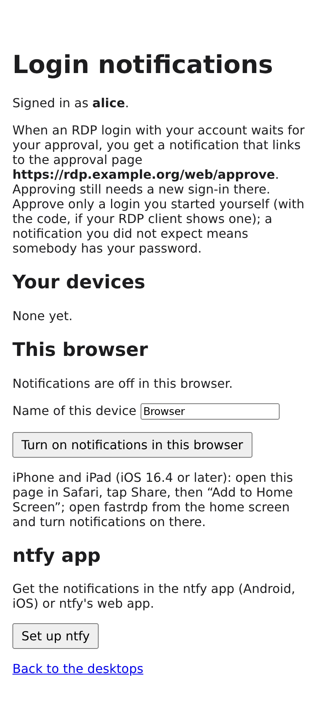
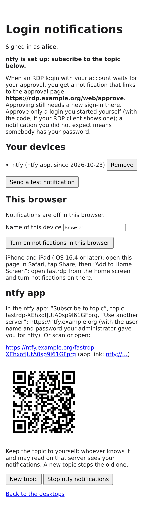

# Approval notifications (ntfy, Web Push)

With web approval (`fastrdp_mfa_mode: web` or `push_or_web`,
[auth-matrix.md](auth-matrix.md#web-approval)) an RDP login waits until its user signs in
on `https://<host>/web/approve` and clicks **Approve**. Users who opted in also get a
notification on their phone or in their browser the moment such a login starts waiting:

> **fastrdp sign-in**
> fastrdp: approve your RDP login from 192.0.2.10 (code 42)? alice, password login at
> 14:03:12 UTC. Approve only a login you started yourself.

Tapping it opens the approval page. **The notification is a hint only:** it carries no
secret and approves nothing; approving still takes the fresh MFA sign-in at the IdP and
the Approve button, and the page lists only the signed-in user's own pending logins. The
link is always the fixed `https://<host>/web/approve`, never a per-login URL.

Off by default. Two channels, usable together:

| | ntfy | Web Push |
|---|---|---|
| What users install | the ntfy app (Android: Google Play or F-Droid; iOS) or nothing (ntfy web app) | nothing: a browser (Chrome, Edge, Firefox, Safari); on iPhone/iPad the page added to the home screen (iOS 16.4+); on Android the browsers need Google Play Services ([without them](#android-without-google-services)) |
| Server side | an ntfy server you run (or ntfy.sh) and an access token | nothing: the browsers' push services (Google FCM, Mozilla, Apple, Microsoft WNS) |
| Content seen by third parties | the ntfy server (and, for iOS, ntfy.sh: see [privacy](#what-leaves-the-host)) | encrypted end to end (RFC 8291); the push service sees only metadata |
| Follow-up when the login ends | a new message only for **denied** or **timed out** (`alert_on_deny`) | the notification is replaced ("… was approved / denied / not approved in time") |

## How it works

1. A login starts waiting for web approval. The broker gives it a random two-digit
   **code** (shown on the [waiting screen](auth-matrix.md#waiting-screen), on the approval
   page and in the notification, so the user can match them) and queues an event
   (`mfa_events`, [architecture.md](architecture.md#trust-boundaries-and-hardening)). The login
   never waits for the notification: the queue is filled without waiting, a full queue
   drops events (counted in `fastrdpctl status`), and nothing is queued while no
   notifier polls.
2. fastrdp-webgate's notifier thread long-polls the broker (op `mfa_events`, webgate uid
   only), looks up the user's subscriptions and hands each message to a small thread
   pool with a 5 s timeout per request. Errors are logged and dropped. The pool's queue
   is bounded (200 sends); above it a message is dropped and logged (`dropped: too many
   notifications queued`).
3. When the login ends (approved, denied, timed out, cancelled by the client) a second
   event follows: Web Push replaces the notification; ntfy sends a warning for denied and
   timed-out logins (`alert_on_deny`).
4. **Rate limit** per user (`rate_limit`, default 3 per 600 s): above it the user gets one
   alert per window without a link, "Several sign-in attempts with your account. If that
   wasn't you, change your password.", and nothing else.

Only logins that wait for web approval are notified: not exempt groups,
`nla_kdc_enforced`, KDC evidence, reconnect grace, or a push in `push_or_web` that is
answered first (that login was already pending, so it is notified; the follow-up says
"approved").

## Users: turning it on

On `https://<host>/web/notify` (also linked from the desktop chooser): sign in as for
the desktop chooser (Keycloak with MFA; a sign-in without a second factor gets *Second
factor required*, [web-access.md](web-access.md#symptom-acr-1-does-not-prove-mfa)). The
page lists the user's devices with
**Remove** and **Send a test notification** (at most one per minute and user; again
within the minute the page says to wait. Test messages are outside the rate limit below
but go through their own small queue, so they never delay an approval notification).

- **This browser (Web Push):** name the device, click *Turn on notifications in this
  browser*, allow notifications. Works in desktop browsers and on Android (Chrome,
  Firefox, Edge, Samsung Internet) with Google Play Services: these browsers receive Web
  Push through Google's FCM; for phones without it see
  [Android without Google services](#android-without-google-services). **iPhone/iPad:** open the page in Safari, *Share → Add to Home Screen*,
  open *fastrdp* from the home screen, sign in there and turn notifications on in that
  window (Apple delivers Web Push only to home-screen web apps, iOS 16.4 or later).
- **ntfy app:** *Set up ntfy* creates the user's own topic (`fastrdp-` and 128 random
  bits). The page shows the server, the topic, a link and a QR code; in the app:
  *Subscribe to topic*, the topic name, *Use another server* with the server URL, and the
  ntfy account the administrator gave the user. *New topic* replaces it (the old one gets
  nothing any more).

 

*`/web/notify` before and after "Set up ntfy" (example data).*

Tell users the rule from [web-access.md](web-access.md#approving-rdp-logins): approve
only a login you started yourself, just now (the waiting screen in the RDP window shows
the same code as the notification and the page). A notification you did not expect means somebody has your password: tap nothing, or open
the page and **Deny**, and change the password. The notification links to the plain
approval page, never to one login: it is sent for whichever login waits, possibly an
attacker's. Only the QR code in the user's own RDP window names a login
([login-bound link](auth-matrix.md#login-bound-link-qr-code)).

## Enabling it (Ansible)

| Variable | Default | Meaning |
|---|---|---|
| `fastrdp_web_notify_backends` | `[]` | `[]` off; `ntfy`, `webpush` or both. Needs `fastrdp_web_enabled` and `fastrdp_mfa_mode` `web` or `push_or_web` (checked: in the other modes nothing would ever be sent) |
| `fastrdp_web_notify_ntfy_url` | `""` | the ntfy server, `https://` (checked) |
| `fastrdp_web_notify_ntfy_token` | `vault_fastrdp_web_notify_ntfy_token` | access token with write access to `fastrdp-*`; written to `/etc/fastrdp/webgate-ntfy.token` (`root:_fastrdp-web 0640`). `""`: publish without a token |
| `fastrdp_web_notify_ntfy_ca_src` | `""` | an ntfy server with a private CA: its CA certificate (PEM on the controller), copied to `/etc/fastrdp/webgate-ntfy-ca.pem` (`ntfy_ca_file` in `webgate.toml`). The webgate then trusts only that CA for ntfy and for Web Push to `fastrdp_web_notify_webpush_extra_hosts` (that server as UnifiedPush distributor); the browsers' push services always use the system trust store. `""`: the system trust store |
| `fastrdp_web_notify_vapid_subject` | `mailto:root@<fqdn>` | contact for the push services (RFC 8292), `mailto:` or `https://` |
| `fastrdp_web_notify_webpush_extra_hosts` | `[]` | push service hosts accepted in addition to the built-in ones (FCM, Mozilla, Apple, WNS), e.g. `[ntfy.example.com]` for [UnifiedPush](#android-without-google-services); DNS names (checked: no URL, port, wildcard or IP address). Exactly these hosts, **not** their subdomains, and only ntfy's UnifiedPush endpoints on them: `https://<host>/up<topic>`, optionally `?up=1` (topic: letters, digits, `_`, `-`). `webpush_extra_hosts` in `webgate.toml` |
| `fastrdp_web_notify_rate_limit` | `"3/600"` | notifications per user and window (1..100 per 60..86400 s) |
| `fastrdp_web_notify_alert_on_deny` | `true` | ntfy: a message when a notified login is denied or times out |
| `fastrdp_web_notify_show_code` | `true` | the two-digit code in the notification |

With `webpush` the role generates the VAPID key once
(`openssl ecparam -name prime256v1 -genkey -noout`, `/etc/fastrdp/webgate-vapid.pem`,
`root:_fastrdp-web 0640`) and keeps it when web push is switched off again: **a new key
invalidates every browser subscription** (users turn notifications on again). Web Push
needs `https://` (service workers), which `fastrdp_web_public_url` is by default.

Subscriptions live in `/var/lib/fastrdp-webgate/notify/<account>.json` (the unit's
`StateDirectory`, `_fastrdp-web`, 0700; files 0600), keyed by the local account the
broker resolves the user to. Removing a file removes that user's subscriptions.

`scripts/fastrdp-setup` asks for them with web approval and browser access: the
backends (`none`, `ntfy`, `webpush`, `both`), and for ntfy the URL, the token (stored in
the vault; also `FASTRDP_WEB_NOTIFY_NTFY_TOKEN`) and the CA file.

`preflight.yml` checks them (*Approval notifications*): the MFA mode and browser access,
ntfy's `/v1/health` from the host, the token at `/v1/account` (refused: FAIL; no token:
WARN), the CA file on the controller, the VAPID subject, and whether the VAPID key exists
already (else `site.yml` generates it). With `fastrdp_web_notify_ntfy_ca_src` the probes do
not verify ntfy's certificate (the CA is on the controller). Write access to `fastrdp-*`
is not visible without publishing: the *Send a test notification* button on `/web/notify`
shows it.

Without Ansible: [manual-setup.md](manual-setup.md#152-web-access-keycloak--guacamole) (`[notify]` in
`webgate.toml`).

## ntfy server recipe

Run ntfy ([docs.ntfy.sh](https://docs.ntfy.sh/config/)) on a host the phones reach, with
access control so that only fastrdp publishes and each user reads only their own topic.
`/etc/ntfy/server.yml`:

```yaml
base-url: https://ntfy.example.com
auth-file: /var/lib/ntfy/user.db
auth-default-access: deny-all
behind-proxy: true
# iOS only: let ntfy.sh wake the iOS app (see below)
upstream-base-url: https://ntfy.sh
```

```sh
# fastrdp publishes: a user with write access to the topics, and a token for it
ntfy user add fastrdp
ntfy access fastrdp 'fastrdp-*' write-only
ntfy token add fastrdp            # -> tk_...: vault_fastrdp_web_notify_ntfy_token
# readers: either one ntfy account per person with access to exactly their topic
# (the topic name is on their /web/notify page) ...
ntfy user add alice
ntfy access alice fastrdp-AbC... read-only
# ... or one shared read-only account for all topics; then the random topic name is the
# only thing that keeps one user from reading another's (128 bits, never listed)
ntfy user add fastrdp-reader
ntfy access fastrdp-reader 'fastrdp-*' read-only
```

Per-person accounts are tighter (a leaked topic name alone reads nothing) but need an
`ntfy access` per user and topic, again after *New topic*. The shared reader is simpler;
treat its password like a group password. In both cases the content is visible to
whoever runs the ntfy server.

**iOS and ntfy:** the iOS ntfy app cannot keep a connection to a self-hosted server in
the background; Apple delivers its notifications through APNs, which only ntfy.sh can
use. With `upstream-base-url: https://ntfy.sh` the server sends ntfy.sh a poll request
per message with the SHA-256 of the topic URL (no content); ntfy.sh wakes the app via
APNs and the app fetches the message from your server. ntfy.sh and Apple see when
messages arrive for that (hashed) topic, not the text. Android works without it: the
ntfy app keeps its own connection to a self-hosted server; the Google Play build uses
Firebase (FCM) for ntfy.sh topics only, the F-Droid build never
([docs.ntfy.sh](https://docs.ntfy.sh/subscribe/phone/)). Web Push is the alternative on
iOS.

## Android without Google services

GrapheneOS without sandboxed Google Play, LineageOS without GApps, /e/OS, CalyxOS,
Huawei phones without GMS: Chrome, Chromium, Edge, Samsung Internet and the stock
Firefox for Android get Web Push only through Google's FCM, so without Google Play
Services *Turn on notifications in this browser* fails or nothing ever arrives. The
opt-in page says so on Android when subscribing fails.

**Recommended: ntfy.** Enable the `ntfy` backend ([recipe](#ntfy-server-recipe)); on the
phone:

1. Install ntfy from F-Droid (the Google Play build works too: for a self-hosted server
   it uses its own connection, not Firebase).
2. Open `https://<host>/web/notify`, *Set up ntfy*, and subscribe with the link or the QR
   code (or by hand: topic, *Use another server*, the ntfy account).
3. Allow ntfy to show notifications (Android 13 and later ask).
4. Exempt ntfy from battery optimisation (*Settings → Apps → ntfy → Battery →
   Unrestricted*; the wording varies), so Android does not stop its connection.
5. The F-Droid build keeps the connection as a foreground service with a permanent
   notification. To hide it, turn off that notification's category (long-press it,
   or ntfy's notification settings); messages still arrive.

**Alternative: Web Push through UnifiedPush.** IronFox and Fennec (Firefox forks from
F-Droid) receive Web Push through a UnifiedPush distributor app instead of FCM
([F-Droid blog](https://f-droid.org/en/2026/01/08/unifiedpush-5-years.html); IronFox 152.0.5,
Fennec 152.0.4). The browser then gives the page the distributor's endpoint:

- **Sunup** (uses Mozilla's push service): the endpoint is presumably on
  `push.services.mozilla.com`, which is allowed by default. Not tested on a device yet.
- **ntfy as distributor:** the endpoint is on the user's ntfy server
  (`https://ntfy.example.com/up…?up=1`). Add that host to
  `fastrdp_web_notify_webpush_extra_hosts` (otherwise the page says "This browser's push
  service is not allowed here."), and let the ntfy server accept anonymous writes to
  UnifiedPush topics: `ntfy access '*' 'up*' write-only`. With
  `visitor-subscriber-rate-limiting` ntfy answers HTTP 507 for a topic nobody is
  subscribed to; the webgate logs it as a refused push. Not tested on a device yet.

The webgate sends the same RFC 8291-encrypted request with VAPID as to any push service
(never the ntfy token), so the ntfy server sees only the encrypted payload.

**microG** may make the Google-dependent browsers receive Web Push; this is not tested
and not supported.

## What leaves the host

| Who | Sees |
|---|---|
| ntfy server (yours) | message text: user name, client address, time, code; topic; when |
| ntfy.sh (iOS app with `upstream-base-url` only) | a hash of the topic URL and the time of each message |
| Apple (APNs, iOS ntfy app) | that the ntfy app got a wake-up, and when |
| push service of the browser (Google FCM, Mozilla, Apple, Microsoft WNS) | the endpoint (a random id of that browser), the server's VAPID public key and contact (`vapid_subject`), sizes, times, `TTL`/`Urgency` and a `Topic` (a hash of the login, not its id). **Not** the text: Web Push payloads are encrypted for the browser (RFC 8291) |
| the phone's lock screen | the notification text (as for any app) |

Nothing contains a password, token, session cookie or the broker's login id; the only
link is the approval page.

## Security notes

- The notification cannot approve anything and does not shorten the approval: an
  attacker who forges or replays one only sends the user to the real approval page.
  The service worker opens only pages of this webgate.
- The webgate POSTs to endpoints that browsers send it. Only `https://` endpoints of the
  known push services are accepted (`webpush_allowed_hosts` in `webgate.toml`: FCM,
  Mozilla, Apple, WNS and their subdomains), so a signed-in user cannot make the webgate
  call internal addresses. Redirects are never followed (the ntfy token never goes
  elsewhere). The list is checked when a browser subscribes and again before every
  send: a stored subscription it no longer accepts (the list was narrowed, a file was
  edited) is removed and logged (`endpoint ... no longer allowed ...; removed`).
- `fastrdp_web_notify_webpush_extra_hosts` (`webpush_extra_hosts`) widens that list:
  add only your own ntfy server. It accepts exactly the named host (no subdomains) and
  only UnifiedPush topic URLs there (`/up<topic>`, optionally `?up=1`). Any signed-in user
  can then make the webgate POST encrypted bodies to any `up*` topic on that host (port
  443); an internal ntfy host becomes reachable from the gateway for exactly that, which
  is the intent. Adding the public ntfy.sh would let users make your gateway publish to
  arbitrary ntfy.sh `up*` topics. Other UnifiedPush distributors with other URL forms
  (e.g. NextPush on Nextcloud) are not accepted.
- Opt-in requires the desktop chooser's sign-in (MFA at the IdP); forms and the
  subscription POST carry the CSRF token; at most 10 devices per user.
- The opt-in page runs only its own script (`<prefix>/static/notify.js`), no inline
  script; its CSP allows `script-src`, `connect-src`, `worker-src` and `manifest-src`
  `'self'`. All other pages keep `default-src 'none'`.
- An attacker with the password can trigger notifications (that is the point: the user
  learns about the attempt); the rate limit keeps it to a few, then one alert.

## Operations

- `fastrdpctl status`: `approval notifications: events sent N, dropped N, queued N, last
  poll …` once the notifier has polled. `dropped` above zero: the notifier was stuck or
  away while logins waited.
- Journal of `fastrdp-webgate`: `approval notifications via ntfy, webpush` at start;
  per message only failures (`ntfy refused … HTTP 403`, `push service refused …`,
  `web push subscription … has expired (HTTP 410); removed`), rate-limit hits and
  subscription changes.
- Test: the *Send a test notification* button on `/web/notify`.
- `preflight.yml`: *Approval notifications* (above).

Not tested on real devices yet: delivery to iOS (home-screen web app, ntfy app with
upstream), Android Chrome/Firefox, IronFox/Fennec with UnifiedPush (Sunup or ntfy),
Windows Edge (WNS), and a real ntfy server; the Web
Push encryption is checked against the RFC 8291 test vector and the requests against
local test servers (`broker/webgate/tests/test_notify.py`).
