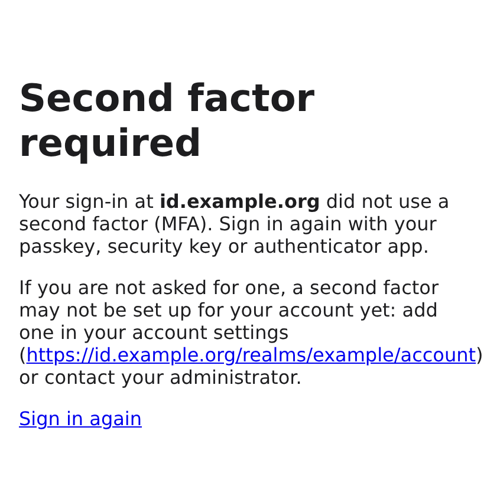
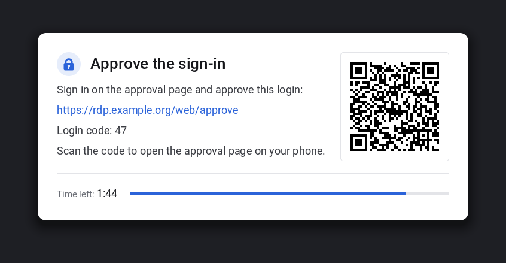

# Web access (browser) – Keycloak + Guacamole

Optional path for users without an RDP client. Enable with `fastrdp_web_enabled: true`
(Ansible role `web_gateway`). Set back to `false`, the next run stops and disables
fastrdp-webgate, the Guacamole containers (quadlets removed) and the KDC proxy, and removes
the nginx site link and `/etc/nftables.d/fastrdp-web.nft`; packages, nginx itself, images,
secrets and `/etc/fastrdp/webgate.toml` stay, so switching it on again keeps the keys.

```
browser ──https──▶ nginx :443
                    ├── /web/        ─▶ fastrdp-webgate (127.0.0.1:8090)
                    │                    1. OIDC login at Keycloak (code flow + PKCE, MFA proven by acr/amr)
                    │                    2. broker: web_token(user) ─▶ one-time "fastrdp-web1:…" token
                    │                    3. encrypted, signed Guacamole connection (30 s) ─▶ redirect
                    │   /web/approve     approve or deny a waiting RDP login (fastrdp_mfa_mode web, push_or_web)
                    └── /guacamole/  ─▶ Guacamole (JSON auth only) ─▶ guacd
                                                                         │ RDP/TLS, user + web token
                                                                         ▼
                                                     fastrdp proxy 127.0.0.1:3389 ─▶ broker ─▶ session
```

## Why it is built this way

- With OIDC, Guacamole never sees a password. Kerberos NLA is impossible from guacd,
  so it connects with TLS and a **one-time web token** instead.
- The broker only accepts a web token:
  - if it was issued to the **webgate's uid** (`[web] gateway_user`);
  - for the **same user**, **once**, within **60 s**;
  - on a login arriving from **guacd's address** (`allowed_clients`, loopback).
- Without TLS logins for RDP clients (`fastrdp_allow_tls_logins: false`) the proxy
  offers TLS only because of guacd, so its module accepts TLS logins **from loopback
  only** (`proxy.ini` `[FastRDP] AllowTlsFrom=127.0.0.1,::1`, variable
  `fastrdp_tls_login_sources`). Other clients get Set Error Info 0x7 before anything
  reaches the broker; NLA is not affected.
- Guacamole only runs the **JSON auth extension**:
  - There are no Guacamole users or passwords.
  - Each login is a connection blob that the webgate signs (HMAC-SHA256) and
    encrypts (AES-128-CBC) with a key only the host knows. Unit tests check that
    the format is byte-identical to Guacamole's `encrypt-json.sh`.
  - A blob is valid for 30 s and carries the single-use web token.
- **MFA happens at Keycloak.** The webgate refuses ID tokens whose `acr` (or `amr`)
  does not prove it, and the broker therefore skips privacyIDEA for web tokens.
- Everything Guacamole-related stays on loopback:
  - guacd is forced to `-b 127.0.0.1`.
  - Tomcat (8080), guacd (4822) and the webgate (8090) are dropped on other
    interfaces by nftables.
  - nginx logs paths only, so OIDC codes and blobs never reach a log file; pages
    send `Referrer-Policy: no-referrer`.

## Hardening after review

- **Web tokens are bound to guacd's real address.** The broker checks the TCP peer
  address of the RDP connection, not the client-supplied *clientAddress* from the
  RDP Client Info PDU. An end-to-end test sends a forged address.
- **The webgate cannot read the proxy's secrets.** `broker.sock` belongs to its own
  group `_fastrdp-broker` (proxy + webgate). The keytab and RDP TLS key stay with
  `_fastrdp-proxy`.
- **The Guacamole key never appears in unit files.** podman reads it at start from
  the root-only `/etc/fastrdp/guacamole.env`. Both containers run with
  `UserNS=auto`, so no container process shares a uid with a local user.
- **guacd pins the proxy certificate** (`cert-fingerprints`, derived from
  `front.crt` on every run) instead of ignoring it. A local process that grabs
  port 3389 while the proxy restarts therefore receives nothing. The format is
  verified against FreeRDP in the end-to-end test.
- **The webgate refuses to start without an MFA proof requirement**
  (`required_acr` / `required_amr_any`), and `amr` must be a list. `allow_without_mfa_proof`
  (webgate.toml only, for an IdP that enforces MFA in a way acr/amr cannot show) covers
  the desktop chooser's sign-in only: [approving RDP logins](#approving-rdp-logins) is
  the RDP login's second factor and always needs `required_acr` or `required_amr_any`.
  Without them the approval page and its decisions are refused ("not set up correctly",
  HTTP 503) and the journal says `login approval refused: [oidc] required_acr and
  required_amr_any are empty`; with `[notify]` backends the webgate does not start.
- **Username claims:** `user@domain` is accepted only for `fastrdp_web_strip_domains`;
  other domains are refused, so `alice@gmail.com` never maps to `alice`. Use a
  directory-backed claim (Keycloak LDAP/AD federation) so users cannot edit it.
- **Logout** is a CSRF-protected POST. The webgate's own login cookie lasts 15 min
  (`fastrdp_web_session_lifetime`); RDP sessions are not affected.

Residual risks:
- guacd (4822) has no authentication. It is reachable from local users on the host
  (remote access is blocked by nftables), who could use it to open outbound
  connections. Run the web path on hosts without untrusted shell users, or put
  guacd on a separate gateway host.
- The `?data=` URL is in the browser history for its 30-second lifetime. The web
  token inside is single-use.

## Keycloak setup

1. Client `fastrdp-web`:
   - OpenID Connect, *Client authentication: on* (confidential), standard flow only.
   - Valid redirect URI: `https://<rdp-fqdn>/web/callback`.
   - Post-logout redirect URI: `https://<rdp-fqdn>/web/`.
   - Put the client secret into `vault_fastrdp_web_oidc_client_secret`.
   - Or import the sample client (all of the above, PKCE, ACR map):
     [Sample client](#sample-client-json-import).
2. MFA via step-up (recommended):
   - Client → Advanced → **ACR to LoA mapping**: `mfa` → `2`.
   - Browser flow with **Condition – Level Of Authentication**: level 1 = username
     and password (LDAP/AD federation), level 2 = OTP, WebAuthn (FIDO2, YubiKey),
     or the privacyIDEA authenticator.
   - The webgate sends `acr_values=mfa` and requires `acr == "mfa"` in the ID token
     (`fastrdp_web_required_acr`). The ACR map alone does not make Keycloak ask for a
     second factor: without a level-2 step it issues `acr` 1 and every sign-in is refused
     ([symptom](#symptom-acr-1-does-not-prove-mfa)).
   - Alternatively use `fastrdp_web_required_amr_any` (e.g. `[otp, hwk]`) if your
     IdP sets `amr`. Single-factor values (`pwd`, `pin`, `user`, …) are refused.
   - **Passkeys** (passwordless): a level-2 sub-flow cannot be satisfied by a passkey
     used at level 1. Use a client policy that forces an MFA-only flow for `acr=mfa`
     instead: [passkeys.md](passkeys.md#recipe-a-acrmfa-via-a-forced-flow-recommended).
     Ansible can set this up (next section).

### Passkeys through Ansible (opt-in)

`fastrdp_web_passkeys: true` makes the web_gateway role configure Keycloak itself
(recipe A of [passkeys.md](passkeys.md)), once per run, from the controller, through
the admin REST API (`roles/web_gateway/files/fastrdp_keycloak_passkeys.py`). With the
default `false` Keycloak is never contacted.

| Variable | Default | Meaning |
|---|---|---|
| `fastrdp_web_passkeys` | `false` | switch |
| `fastrdp_keycloak_admin_url`, `fastrdp_keycloak_realm` | from `fastrdp_web_oidc_issuer` | Keycloak base URL and realm |
| `fastrdp_keycloak_client_id` | `fastrdp_web_oidc_client_id` | client that gets the ACR map |
| `vault_fastrdp_keycloak_admin_client_secret` | – | preferred: service-account client (`fastrdp_keycloak_admin_client_id`, realm `fastrdp_keycloak_admin_realm`) with *manage-realm* + *manage-clients* |
| `fastrdp_keycloak_admin_user` + `vault_fastrdp_keycloak_admin_password` | – | alternative: admin user (password grant via `admin-cli`) |
| `fastrdp_keycloak_mfa_flow`, `_acr`, `_loa` | `fastrdp-mfa`, `mfa`, `2` | forced flow, ACR value (must be in `fastrdp_web_required_acr`), level |
| `fastrdp_keycloak_second_factors` | `[auth-otp-form, webauthn-authenticator]` | alternatives after a password (add the privacyIDEA provider's id) |
| `fastrdp_web_passkeys_mediation` | `conditional` | passkey autofill |
| `fastrdp_web_passkeys_hardware_only`, `fastrdp_web_passkeys_aaguids` | `false`, `[]` | attestation `direct` + AAGUID allow-list |

What it writes, and nothing else:
- the realm's WebAuthn **passwordless** policy (UV required, discoverable credential
  required, passkeys enabled, mediation; attestation `none` or, hardware-only,
  `direct` + AAGUIDs) and the required action *Webauthn Register Passwordless*;
- the flow `fastrdp-mfa` without a *Cookie* step (rebuilt when it differs, e.g. when
  someone added a Cookie step; a built-in flow of that name is refused);
- client profile `fastrdp-mfa-flow` (`auth-flow-enforcer`) and policy `fastrdp-mfa`
  (`acr-condition: mfa`). Keycloak's PUT replaces all client profiles/policies, so the
  role reads, merges and writes back: other profiles and policies stay;
- the client's ACR-to-LoA map entry `mfa → 2`, other entries kept.

`--check` lists what would change and writes nothing; a second run reports
`changed=0`. Hardware-only also needs the vendors' attestation roots in Keycloak's
truststore (server option `truststore-paths`, not settable over REST): without them
every registration fails with `invalid cert path`. Run only this part:
`ansible-playbook site.yml --tags keycloak`.

Tested end to end against Keycloak 26.8.1 with headless Chromium and a virtual
authenticator (`make test-keycloak`, tests/keycloak/run.sh; results in
[passkeys.md](passkeys.md#stage-1-results-keycloak-2681)).
3. User names: the `preferred_username` claim must equal the Linux account name (as
   SSSD resolves it). A `@realm` suffix is stripped. Use `fastrdp_web_username_claim`
   for a different claim.

Without Ansible: [examples/keycloak-mfa/](examples/keycloak-mfa/README.md) sets up the same
flow and client policies by hand (`kcadm.sh` script, admin console JSON, keycloak-config-cli,
realm import).

### Sample client (JSON import)

[docs/examples/keycloak-fastrdp-web-client.json](examples/keycloak-fastrdp-web-client.json)
(packaged: `/usr/share/doc/fastrdp-webgate/examples/`) is the client `fastrdp-web` as
the webgate needs it. Import it into the realm of `fastrdp_web_oidc_issuer`:
- admin console: *Clients → Import client*, choose the file, *Save*;
- or `kcadm.sh create clients -r <realm> -f keycloak-fastrdp-web-client.json`.

Before importing, replace the host `rdp1.lab.example.com` (the placeholder of
webgate.toml.example) with your `fastrdp_web_public_url` host; it occurs in
`redirectUris`, `baseUrl` and `post.logout.redirect.uris`. The file has no secret:
Keycloak generates one on import. Copy it (*Credentials* tab, or
`kcadm.sh get clients/<id>/client-secret -r <realm>`) into
`vault_fastrdp_web_oidc_client_secret`.

| Field | Value | |
|---|---|---|
| `publicClient`, `clientAuthenticatorType` | `false`, `client-secret` | essential: confidential client |
| `standardFlowEnabled` | `true`; implicit, direct access grants, service accounts, device flow, CIBA off | essential: code flow only |
| `redirectUris` | `https://<host>/web/callback` | essential (the webgate's `<public_url>/web/callback`) |
| `post.logout.redirect.uris` | `https://<host>/web/` | essential for the logout button |
| `pkce.code.challenge.method` | `S256` | essential: Keycloak refuses logins without PKCE; the webgate always sends S256 |
| `acr.loa.map` | `{"mfa":2}` | essential with `fastrdp_web_required_acr: [mfa]` (the default) |
| `defaultClientScopes` | `acr`, `basic`, `profile` | essential: claims `acr`, `sub`/`auth_time`, `preferred_username` |
| `optionalClientScopes` | `email` | default; not used by fastrdp |
| `consentRequired`, `fullScopeAllowed` | `false`, `false` | defaults chosen here: no consent screen, no realm roles in tokens |
| `frontchannelLogout`, `webOrigins`, `use.refresh.tokens` | `false`, none, `false` | the webgate has no logout channel, no CORS and uses no refresh token |

A claim other than `preferred_username` (`fastrdp_web_username_claim`) needs its own
mapper or client scope; keep it directory-backed (see Hardening).

The client alone gives MFA only together with a realm flow that sets level 2 (step 2).
`fastrdp_web_passkeys: true` configures that flow, the client policy and the ACR map
entry ([above](#passkeys-through-ansible-opt-in)), but not the client itself: import
it first. Keycloak's *Partial import* (realm settings) cannot carry the flow or the
client policies (it covers users, groups, clients, roles and identity providers only;
checked on 26.8.1), so there is no JSON for them. Without Ansible, run the role's
script by hand; it only needs python3 and an admin login:

```sh
echo '{"admin_url": "https://keycloak.lab.example.com", "realm": "lab",
       "admin_user": "admin", "admin_password": "…", "check": true}' |
  python3 ansible/roles/web_gateway/files/fastrdp_keycloak_passkeys.py
```

`"check": true` lists the changes; drop it to apply. Settings and defaults: the
script's `settings()` (flow `fastrdp-mfa`, `acr` `mfa`, `loa` 2, …). After an import of
the sample client the ACR map entry is already there and the script leaves it alone.

`make test-keycloak` imports the sample into Keycloak 26.8.1 and compares what Keycloak
stores with the file, then runs the browser logins of the end-to-end test against a
client made from it.

### Symptom: acr '1' does not prove MFA



Users get the page **Second factor required** ("Your sign-in at <Keycloak host> did not
use a second factor (MFA) …", with a link to the account console `<issuer>/account` and
*Sign in again*) on `/web/`, `/web/approve` or `/web/notify`, and the journal of
`fastrdp-webgate` says:

```
WARNING fastrdp.webgate: OIDC login of alice refused: acr '1' does not prove MFA (required: mfa; amr: None). Keycloak issues acr 'mfa' only with a level-2 (MFA) step for this client: fastrdp_web_passkeys: true, or a step-up browser flow (docs/web-access.md#keycloak-setup)
```

Keycloak issued `acr` 1 (password only). Either the realm has no level-2 step for
`acr=mfa` (the client's ACR map, also the one of the sample client, only names the
level; it does not create a flow that reaches it), or this user signed in without a
second factor. Fix one of:
- `fastrdp_web_passkeys: true` with admin credentials
  ([above](#passkeys-through-ansible-opt-in); `scripts/fastrdp-setup` asks for them), then
  `ansible-playbook site.yml --tags keycloak`;
- a step-up browser flow by hand (step 2), or a client policy forcing an MFA flow for
  `acr=mfa` ([passkeys.md](passkeys.md#recipe-a-acrmfa-via-a-forced-flow-recommended)).

Then every user needs a second factor (passkey, security key, authenticator app) in
Keycloak; users without one add it in the account console. `make preflight` warns
(*Keycloak MFA for acr=mfa*) when `fastrdp_web_passkeys` is off and the discovery
document shows no step-up; the client's ACR map and client policies are not visible
there, so it cannot confirm a hand-made setup. Other refusals (state, token, a reused
Keycloak session on `/web/approve`) keep the page *Login was not accepted*; the journal
line `OIDC login refused: …` names the reason.

## RDP apps

mstsc and the Windows App have no field for the desktop (FreeRDP and Remmina do:
[client-guide.md](client-guide.md)). The chooser page at `https://<rdp-fqdn>/web/`
therefore also lists, under **Remote Desktop app**, every desktop the broker allows the
user (also those not offered in the browser, `fastrdp_web_desktops`), with two actions:

- **Use for Remote Desktop logins** stores that desktop in the broker
  (`/var/lib/fastrdp/desktop-prefs/<user>`, root only, op `web_set_desktop`). Every
  later RDP login without a client hint gets it, ahead of `~/.config/fastrdp/desktop`
  and the group default ([desktop-matrix.md](desktop-matrix.md#choosing-a-desktop)).
  **Use the default again** removes it. The page shows which desktop RDP logins get
  now, and whether it was chosen there. The broker checks the desktop against the
  user's allowed desktops when it is chosen and again at every login. Admins see,
  set and remove it with `fastrdpctl desktop USER [DESKTOP | --clear]` (root; it
  also tells which desktop RDP logins get now and why,
  [desktop-matrix.md](desktop-matrix.md#choosing-a-desktop)).
- **Download .rdp file** gives an `.rdp` file (`application/x-rdp`) for that desktop:
  `full address` (`fastrdp_web_rdp_host`, default `fastrdp_fqdn`, and
  `fastrdp_web_rdp_port`, default `fastrdp_listen_port`, written only if not 3389),
  `alternate shell:s:fastrdp:<desktop>` and the settings of
  [client-guide.md](client-guide.md#windows-remote-desktop-connection-mstsc) (NLA with
  CredSSP, `authentication level:i:2`, network auto-detection), and sound and
  microphone as the server offers them: `audiomode:i:0` (play on this computer; `2`
  with `fastrdp_audio: false`) and `audiocapturemode:i:1` (record from this computer;
  `0` with `fastrdp_audio_input: false` or `fastrdp_audio: false`;
  [audio.md](audio.md#implementation-backlog-a1)). It holds no user name,
  password or token: the user logs in as usual, with the UPN. The file is not signed,
  so mstsc warns that the publisher cannot be identified.

Both need the chooser's sign-in; the button is a CSRF-protected POST. Set
`fastrdp_web_rdp_host` when clients reach the proxy under another name than
`fastrdp_fqdn` (it must be a DNS name with a `TERMSRV/` principal, never an IP
address), and `fastrdp_web_rdp_port` when a forwarded port differs from the proxy's.

## Approving RDP logins

With `fastrdp_mfa_mode: web` or `push_or_web` the web gateway is also where users
approve their **native RDP logins** (mstsc, xfreerdp3, Remmina): the second factor of
an RDP login becomes "sign in with MFA in a browser and click Approve". Modes, settings
and the broker's checks: [auth-matrix.md](auth-matrix.md#web-approval).

 

*The waiting screen in the RDP window and the approval page opened from its QR code (example data).*

How users reach it:
- Start the RDP login as usual. The client waits (90 s by default,
  `fastrdp_mfa_web_approval_timeout`); the [waiting screen](auth-matrix.md#waiting-screen)
  (`fastrdp_proxy_waiting_screen`, on by default) shows in the RDP window what to do,
  the time left, the approval URL, the login's code and a **QR code** that opens the
  page for this very login. Without it the window stays black or shows "connecting…".
- Open `https://<rdp-fqdn>/web/approve` (typed, or a bookmark), or scan the QR code in
  the RDP window with the phone's camera, which opens
  `https://<rdp-fqdn>/web/approve?login=<id>`, then sign in there with the passkey or
  authenticator app on the phone. The webgate always
  sends the browser to Keycloak for a **new** sign-in (`prompt=login`, `max_age=0`,
  plus `acr_values=mfa` as for desktops), even if the user is signed in there already,
  and refuses ID tokens whose `auth_time` shows a reused Keycloak session.
- The page shows each waiting login of that user: client address, start time and age,
  NLA or password login, its two-digit **code** (the waiting screen shows the same) and
  the buttons **Approve** and **Deny**. "No RDP login is
  waiting" otherwise (reload after starting the login).
- Opened from the QR code, the page shows **that login** first under *This RDP login*,
  with Approve and Deny. Other waiting logins of the user follow with "Another login
  with your password is waiting. Deny it if it is not yours." and only Deny. While
  others wait, a red warning box above the buttons shows this login's code in large
  type: approve only if your own RDP window shows that code, deny a link somebody sent
  you. Approving then is logged as a warning by the webgate and the broker.
- Approve: the RDP client continues at once. Deny: the client gets "access denied"
  (Set Error Info 0x7). Nothing: it gives up after the timeout (0x409).

What the page protects against:
- **Only the signed-in user's logins** are shown or decided; the broker answers these
  requests (`mfa_pending`, `mfa_decide`) only from the webgate's uid and checks the
  account again.
- The forms are CSRF-protected POSTs. The sign-in for this page is a separate cookie
  (`fastrdp_web_approve`, 5 min) that cannot open desktops, and the desktop chooser's
  sign-in cannot approve logins.
- A sign-in may be at most `fastrdp_mfa_web_approval_max_auth_age` (30 s) older than
  the login it approves; otherwise the page asks to sign in again.
- **Two or more waiting logins** (`fastrdp_mfa_web_approval_single_pending`): the page
  warns that somebody else may be using the password and offers only Deny. Deny them
  all and start one new login. Opened from the QR code of your own RDP window, the
  login named there can still be approved (below).

**Why the QR code binds the approval.** The QR code encodes the login's id, a random
value (128 bits) the broker made for exactly the login in that RDP window. Somebody who
has the password and starts a login of their own at the same time gets a different id,
shown only on their screen, so scanning your own screen approves your own login and
never theirs; theirs stays waiting and can be denied. The id is **not a credential**:
the page still wants your fresh sign-in with MFA, only logins of the signed-in user are
found, and an unknown, finished or foreign id gets the same "This login is no longer
waiting for approval." (a malformed one at once, without a sign-in). The `login`
parameter travels through the Keycloak sign-in in the signed sign-in cookie, like the
page to return to. Typed URLs, bookmarks and notifications carry no id and get the plain
page. Details: [auth-matrix.md](auth-matrix.md#login-bound-link-qr-code).

**A link from somebody else is not yours.** An attacker with the password could send
you the link of *their* login ("please approve, it's urgent"). The page then shows a
login whose address, start time and code match nothing in your RDP window (and, if
your own login waits too, the red warning box): deny it.
Scan only the QR code in your own RDP window and never approve a login you did not
start.

**Notifications on the phone** (opt-in, `fastrdp_web_notify_backends`;
[notifications.md](notifications.md)): users turn them on once at
`https://<rdp-fqdn>/web/notify` (signed in like the desktop chooser):
- *this browser* (Web Push): name the device, *Turn on notifications*, allow them. On
  iPhone/iPad first open the page in Safari, *Share → Add to Home Screen*, start fastrdp
  from the home screen and turn notifications on there (iOS 16.4+);
- *ntfy app*: *Set up ntfy*, then subscribe to the topic shown (QR code) on the
  organisation's ntfy server.
- Android without Google services (GrapheneOS, LineageOS, /e/OS, ...): browsers there get
  no Web Push; use the ntfy app (F-Droid) or see
  [Android without Google services](notifications.md#android-without-google-services).

Then every RDP login waiting for their approval brings "approve your RDP login from
192.0.2.10 (code 42)"; tapping it opens the approval page, where the sign-in and the
buttons work as above. The link **always points to `https://<rdp-fqdn>/web/approve`**,
never to one login (whichever login waits triggers the notification, possibly an
attacker's): a notification or message with any other link is not from fastrdp. Approve only a login
you started yourself (with the [waiting screen](auth-matrix.md#waiting-screen) the RDP
window shows the same code).

**Social engineering.** The danger of every approve button is an attacker who already
has the password and asks the user, by phone or chat, to "approve the login quickly".
Tell users: approve only a login you started yourself, just now, from the address
shown; deny anything else and report it. **Deny** is always offered and always works,
also with an old sign-in or several waiting logins; a denied login is logged by the
broker (`web approval for alice from … DENIED`) and is a reason to change the password.

## Limits

- **No H.264 in the browser path.** The official `guacamole/guacd:1.6.0` image is
  built with FreeRDP 2 and without FFmpeg/OpenH264. guacd re-encodes the screen
  as images for the browser anyway. Expect noticeably lower frame rates than native
  clients; the web path is for convenience and occasional use.
- **No Kerberos ticket** in sessions started from the browser (no password ever
  reaches the server). Users can run `kinit` inside the session.
- **Clipboard, audio and file transfer** follow Guacamole's capabilities; printing
  and USB redirection are not available.
- **Sound and microphone.** Sound plays in the browser by default (Guacamole's
  `rdpsnd`, PCM) on X11/wlroots desktops and GNOME [GNOME through its `rdpsnd`
  fallback: not verified]; Plasma (KRdp) has none. The microphone follows
  `fastrdp_audio_input` (Guacamole `enable-audio-input`; an `enable-audio-input` in
  `fastrdp_web_rdp_parameters` wins). Browsers give web pages the microphone only over
  HTTPS and after the user allows it; the browser asks once guacd accepts the
  microphone stream [when exactly: not verified], and a denied permission leaves the
  session without it.
  Quote values in `fastrdp_web_rdp_parameters` or write YAML `true`/`false`: both reach
  Guacamole as `"true"`/`"false"`. ([audio.md](audio.md))
- **Images** are pulled from Docker Hub by tag (`fastrdp_guacamole_version`). Mirror
  or pin by digest for production.

## KDC proxy

Optional, for **native RDP clients** outside the internal network: with
`fastrdp_web_kdcproxy: true` the same nginx also serves `https://<fqdn>/KdcProxy`, a
Kerberos KDC proxy (MS-KKDCP). Clients send their Kerberos requests there over HTTPS
and can do Kerberos NLA without a VPN. Without a reachable KDC, Windows falls back to
NTLM, which fastrdp refuses; the other ways out are a VPN, TLS logins (password + OTP)
or the browser path above ([windows-clients.md](windows-clients.md) §3.10).

```
mstsc / FreeRDP / kinit ──https POST /KdcProxy──▶ nginx :443   (POST only, 128 KiB, limit_req per address)
   ──▶ /run/fastrdp-kdcproxy.sock ──▶ gunicorn + python3-kdcproxy (DynamicUser)
   ──TCP 88 (kpasswd 464)──▶ KDCs of fastrdp_realm only
```

| Variable | Default | Meaning |
|---|---|---|
| `fastrdp_web_kdcproxy` | `false` | switch; needs `fastrdp_web_enabled: true` |
| `fastrdp_web_kdcproxy_kdcs` | `[]` | KDCs as `host` or `host:port` (port 88 if none). `[]`: the SRV records `_kerberos._tcp.<realm in lower case>`, looked up on the host at every run (run the playbook again when the KDCs change) |
| `fastrdp_web_kdcproxy_kpasswd` | `true` | also forward password changes (kpasswd, e.g. `kinit` with an expired password): `_kpasswd._tcp` SRV records, else port 464 of the KDCs |
| `fastrdp_web_kdcproxy_rate_per_minute`, `fastrdp_web_kdcproxy_burst` | `60`, `20` | nginx `limit_req` per client address; more gets HTTP 429. A login takes about 3 to 6 requests. Clients behind one NAT address share the limit |

Packages: `python3-kdcproxy` (1.0.0) and `gunicorn` (Debian 13: 23.0.0, main; Ubuntu
26.04: 25.1.0, **universe**). The preflight checks that both are installable and that
the KDCs answer on TCP from the host.

**Only the site's realm.** `/etc/fastrdp/kdcproxy.conf` has one section for
`fastrdp_realm` (and the same in lower case, as realm names are case-sensitive there)
naming the KDCs, and `use_dns = false`. Verified with python-kdcproxy 1.0.0 and a fake
KDC (`tests/ansible/kdcproxy_check.py`):
- A request for any other realm, a differently cased realm or no realm gets HTTP 503
  and nothing is sent anywhere.
- With DNS lookups on (kdcproxy's default), the proxy would look up `_kerberos._tcp`
  of whatever realm a client names and forward there: an open proxy into every network
  the host can reach.
- kdcproxy silently ignores a missing or unreadable config file and then uses DNS. The
  unit therefore refuses to start unless it can read the file and finds
  `use_dns = false` in it.
- Only messages that parse as AS-REQ, TGS-REQ or kpasswd requests are forwarded, over
  TCP, to the listed servers. kdcproxy does not compare the realm inside the request
  with the one the client names; such a request still only reaches your KDCs, which
  answer with an error.

**nginx** forwards `/KdcProxy` from the HTTPS server only (port 80 only redirects),
POST only (other methods: 403), at most 128 KiB per request (kdcproxy's own limit;
larger: 413), rate-limited per client address (429). The service runs as a dynamic
user without capabilities or secrets; only nginx (`www-data`) may connect to its
socket.

**Exposure: read before enabling.** Anyone who can reach the web gateway can now send
Kerberos requests to your KDCs:
- **Password guessing** through pre-authentication, and **account enumeration**
  (unknown principal vs. pre-authentication required).
- **AS-REP roasting** of accounts that do not require pre-authentication (AD: "Do not
  require Kerberos preauthentication"; MIT: principals without `+requires_preauth`): the
  KDC hands out a reply encrypted with the user's key for offline cracking, and logs a
  successful issue, not a failure.
- **Kerberoasting** by any user who knows one password: service tickets for accounts
  with weak passwords, now from the internet.

What helps:
- An **account lockout policy** at the KDC (AD: account lockout threshold; FreeIPA:
  `ipa pwpolicy-mod --maxfail --failinterval --lockouttime`; MIT: `maxfailure` in the
  password policy). Lockout also lets an attacker lock users out; choose the threshold
  with that in mind.
- Pre-authentication required for every account; strong passwords for service accounts.
- The nginx rate limit: it slows one address, not a distributed attack.
- Monitoring: nginx logs every request with the real client address
  (`/var/log/nginx/fastrdp-web.log`, 429 = rate limit), for example for fail2ban. The KDC
  sees the web gateway's address as the client (AD event 4771 for failed
  pre-authentication).
- Smartcards or passkeys instead of passwords where possible
  ([smartcard-nla.md](smartcard-nla.md), [passkeys.md](passkeys.md)).

TLS between client and proxy also hides the Kerberos exchange from network observers,
which plain TCP/UDP 88 does not.

**Certificate.** nginx uses the front certificate (`fastrdp_front_cert_src`). Clients
must trust it and its name must match the host in the proxy URL; the self-signed lab
certificate only works for MIT clients with `http_anchors`.

**Clients** ([client-guide.md](client-guide.md), details:
[freerdp-client.md](freerdp-client.md) §7, [windows-clients.md](windows-clients.md) §3.10):
- Windows: GPO *Computer Configuration → Administrative Templates → System → Kerberos →
  Specify KDC proxy servers for Kerberos clients*: realm → `<https rdp1.example.com:443:KdcProxy />`.
- Linux (MIT krb5, also what FreeRDP uses): in `/etc/krb5.conf`
  ```
  [realms]
      EXAMPLE.COM = {
          kdc = https://rdp1.example.com/KdcProxy
          kpasswd_server = https://rdp1.example.com/KdcProxy
      }
  ```
  and the package `krb5-k5tls` (Debian/Ubuntu; only suggested by `krb5-user`). Without
  it MIT reports `Cannot contact any KDC for realm ...`; `KRB5_TRACE=/dev/stderr` shows
  `Could not find tls plugin module named 'k5tls'`.
- FreeRDP additionally has `/kerberos:kdc-url:rdp1.example.com` (the host, not a URL), but
  it covers only the first ticket: the `krb5.conf` entry is needed anyway.

**Tested** without systemd and Windows (scratch, not CI): MIT `kinit` + `kvno
TERMSRV/...` (krb5 1.22.1, `krb5-k5tls`) → the rendered nginx site (nginx 1.28.3,
Ubuntu 26.04 package) → gunicorn 23.0.0 and 25.1.0 → python-kdcproxy 1.0.0 → a scratch
MIT KDC. A wrong password reached the KDC as `PREAUTH_FAILED`; another realm failed
with `Cannot contact any KDC`; GET 403, 200 KiB 413, more than the burst 429. A
malformed body gets HTTP 500 with a Python traceback in the journal (a bug in
kdcproxy 1.0.0's error path), not 400. Open: the systemd units on a host, the Windows
GPO path with mstsc, AD as the KDC, kpasswd through the proxy.

## Files and services

| | |
|---|---|
| `fastrdp-webgate.service` | `broker/webgate/` (Python, needs `python3-cryptography`), user `_fastrdp-web` |
| `fastrdp-guacd.service`, `fastrdp-guacamole.service` | podman quadlets in `/etc/containers/systemd/` |
| `/etc/fastrdp/webgate.toml` | config (example: `broker/webgate/config/webgate.toml.example`) |
| `/etc/fastrdp/guacamole-json.key` | 128-bit key shared by webgate and Guacamole (generated once) |
| `/etc/fastrdp/webgate-cookie.secret` | signs the webgate's session cookies (generated once) |
| `/var/lib/fastrdp/desktop-prefs/` | broker (root, 0700): desktop chosen for RDP logins per user ([RDP apps](#rdp-apps)) |
| `/var/lib/fastrdp-webgate/notify/` | webgate (`_fastrdp-web`, 0700): users' notification subscriptions ([notifications.md](notifications.md)) |
| `/etc/fastrdp/webgate-vapid.pem`, `/etc/fastrdp/webgate-ntfy.token` | Web Push (VAPID) key, ntfy token (`root:_fastrdp-web 0640`; notifications only) |
| `/etc/nginx/sites-enabled/fastrdp-web.conf` | TLS front (same certificate as the RDP front-end) |
| `fastrdp-kdcproxy.socket`, `fastrdp-kdcproxy.service` | KDC proxy (opt-in): socket `/run/fastrdp-kdcproxy.sock` (`root:www-data 0660`), gunicorn as a dynamic user |
| `/etc/fastrdp/kdcproxy.conf`, `/etc/fastrdp/kdcproxy-gunicorn.conf.py` | KDC proxy: realm and KDCs, gunicorn settings (removed again with `fastrdp_web_kdcproxy: false`) |
